# Ouroboros MCP 구성 Architecture

> Capability Challenge의 참고 자료입니다. 실제로 배포되는 큰 MCP 서버 하나를 끝까지 뜯어보고, **작은 서버(도구 3~5개)를 만들 때 무엇을 가져오고 무엇은 가져오지 않을지**를 정리합니다.
>
> - **대상:** `Day06/ouroboros/`에 들어 있는 스냅샷. 원본은 github.com/Q00/ouroboros, 커밋 `97098488`(2026-09-13, `Day06/HARNESSES.md:12`), plugin 버전 0.54.4(`.claude-plugin/plugin.json:3`)
> - **경로 표기:** 이 문서의 `파일:줄`은 모두 **`Day06/ouroboros/` 기준**입니다. 예: `src/ouroboros/mcp/server/adapter.py:772`는 `Day06/ouroboros/src/ouroboros/mcp/server/adapter.py`의 772행입니다.
> - **근거 수준:** 표시가 없으면 코드에서 확인한 것입니다. **[정의만]**은 코드는 있지만 호출하는 곳을 찾지 못한 것, **(추정)**은 구조를 보고 짐작한 것입니다.
> - **SDK 버전 주의:** 서버는 `mcp==2.0.0`에 고정돼 있습니다(`pyproject.toml:84`). 이 저장소의 루트 환경에는 2.0.0이 없어 SDK 내부 동작은 **mcp 2.3.0** 소스로 확인했습니다. 그 부분에는 "(2.3.0 기준)"이라고 적었습니다.
> - **그림:** 주요 구성을 mermaid 그림 12장으로 그렸습니다(아래 "그림 목록"). GitHub 웹 화면처럼 mermaid를 그려 주는 Markdown 뷰어에서 그림으로 보이고, 터미널에서는 소스 그대로 보입니다. 그림은 본문 표와 근거를 요약한 것이고, `파일:줄` 근거는 본문에 있습니다.
> - **조사 방법:** 2026-11-04에 서버 핵심, 도구와 장기 작업, 클라이언트와 브리지, plugin·Skill·문서의 네 영역으로 나눠 소스를 읽었고, 결론을 좌우하는 주장은 다시 직접 대조했습니다. bridge(10.4절)만 저장소 밖 복사본에서 모델 호출 없이 실행해 확인했고, 나머지는 실행하지 않았습니다.

---

## 0. 한 문단 요약

Ouroboros는 Claude Code 같은 코딩 에이전트 **앞에** 서서 "요구가 모호하면 코드를 쓰기 전에 막는" 계층입니다. 그 기능의 몸통이 MCP 서버 `ouroboros mcp serve` 하나입니다. 이 서버는 도구 36개와 리소스 4종을 노출합니다(프롬프트는 없음). 상태는 SQLite 이벤트 저장소에 쌓고, 오래 걸리는 일은 **job**(시작 → 관찰 → 결과)으로 바꿔 별도 프로세스에서 돌립니다. 동시에 Ouroboros는 MCP **클라이언트**이기도 합니다. Codex와 GJC를 MCP 서버로 띄워 작업자로 부리고, 사용자가 설정한 외부 MCP 서버(bridge)에 연결해 도구 목록을 가져옵니다. 다만 가져온 외부 도구를 작업자가 실제로 부르게 하는 경로는 없습니다(10.4절). Claude Code에는 plugin으로 배포되며, Skill 22개가 "언제 어떤 도구를 어떤 순서로 부를지"를 맡습니다.

### 그림 목록

| 그림 | 무엇을 보여 주나 | 절 |
|---|---|---|
| 1 | 전체 구성: 호스트, 서버의 여섯 층, 서버 밖의 프로세스, 저장소 | 1 |
| 2 | 기동 순서와 기동을 멈추는 곳 | 2.4 |
| 3 | `tools/call` 한 번이 지나가는 길 | 3 |
| 4 | 도구끼리 ID로 이어지는 법 | 4.3 |
| 5 | 오류가 호스트에 보이는 세 채널 | 5.1 |
| 6 | 오래 걸리는 작업이 detached worker로 가는 길 | 6.2 |
| 7 | job 상태 | 6.2 |
| 8 | 중복 호출 방지: 막는 실패, 장치, 저장 위치 | 7 |
| 9 | 네트워크 노출 규칙 | 9.1 |
| 10 | MCP 클라이언트로서 붙는 곳과 재귀 차단 | 10.3 |
| 11 | bridge: 연결은 되고 호출은 끊긴 곳 | 10.4 |
| 12 | Skill과 서버의 역할 분담 | 11.1 |

---

## 1. 구성도

**그림 1. 전체 구성.** 위에서 아래로 읽습니다. Claude Code가 plugin의 `.mcp.json`으로 서버를 띄우고, Claude가 `tools/call`을 보내면 서버 안의 여섯 층을 거칩니다. 오래 걸리는 일과 실제 작업은 서버 밖의 프로세스가 맡습니다. 점선은 "목록만 받고 호출은 없다"는 뜻입니다(10.4절).

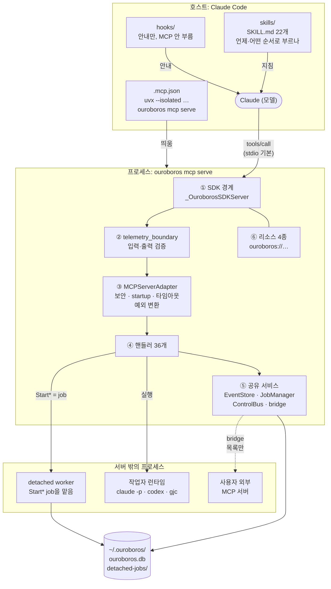

| 상자 | 하는 일 | 자세히 |
|---|---|---|
| ① SDK 경계 | `list_tools`·`call_tool`을 오버라이드해 손으로 쓴 정본 스키마를 냄 | 3절 |
| ② telemetry_boundary | 입력(enum, JSON Schema 2020-12)과 출력 스키마를 검증하고, 결과·오류를 SDK 모양으로 바꾸고, 텔레메트리를 1회 남김 | 3절, 9.5절 |
| ③ MCPServerAdapter | 핸들러 조회 → SecurityLayer → startup → 타임아웃 → `handle` → 예외를 `MCPToolError`로 | 3절, 5절 |
| ④ 핸들러 36개 | interview · seed · execute · evaluate · evolve/ralph · job · 조회 · conductor · fan-out | 4절 |
| ⑤ 공유 서비스 | EventStore(SQLite) · JobManager · SeedHandoffRegistry · FanoutRegistry · BrownfieldStore · ControlBus · (선택) MCP bridge | 6절, 8절, 10.4절 |
| ⑥ 리소스 4종 | `ouroboros://seeds` · `sessions` · `sessions/current` · `events` | 8절 |
| detached worker | Start* job을 별도 프로세스에서 같은 핸들러로 실행 | 6절 |
| 작업자 런타임 | `claude -p` 워커, `codex mcp-server`, `gjc mcp-serve`. 자식에게서 Ouroboros 자신은 끔 | 10.1절, 10.3절 |
| 외부 MCP 서버 | bridge로 연결해 도구 목록만 받음 | 10.4절 |
| hooks | 세션 시작·키워드·drift 안내. MCP를 부르지 않고 언제나 fail-open | 11.5절 |

---

## 2. 배포와 기동

### 2.1 호스트마다 등록하는 법

| 호스트 | 매니페스트 | 서버를 띄우는 명령 | 버전 고정 |
|---|---|---|---|
| Claude Code plugin | `.claude-plugin/plugin.json:24-25` (`"skills": "./skills/"`, `"mcpServers": "./.mcp.json"`) | `uvx --isolated --python >=3.12 --from ouroboros-ai[mcp]… ouroboros mcp serve --runtime claude-cli --llm-backend claude_code` | 루트 `.mcp.json:10`은 고정 없음, `.claude-plugin/.mcp.json:10`은 `==0.54.4` |
| Codex plugin | `.codex-plugin/plugin.json:22-23` | 루트 `.mcp.codex.json` | `==0.54.4` (`.mcp.codex.json:10`) |
| DeepSeek Harness | `integrations/dsh-plugin/cordis.patch.yml:43-57` | `--from ouroboros-ai[mcp] --with mcp==2.0.0` | `--isolated` 없음 |
| Kiro, Copilot, Hermes 등 | `ouroboros setup --runtime X`가 호스트 설정에 기록 (`src/ouroboros/cli/commands/setup.py:3207-3234`) | `uvx --isolated` 또는 `pipx run` (`src/ouroboros/cli/commands/setup.py:131-149`) | 고정 없음 |

### 2.2 왜 `--isolated`이고 왜 버전을 고정하나

- **MCP SDK 메이저 버전이 둘 섞여 있습니다.** 서버용 `[mcp]` extra는 `mcp==2.0.0`이고, Claude Agent SDK용 `[claude]`·`[claude-sdk]`는 `mcp==1.28.1`입니다(`pyproject.toml:76-84`). uv의 `conflicts`로 둘을 같은 환경에 설치하지 못하게 막았습니다(`pyproject.toml:186-197`). 그래서 서버는 **별도 프로세스, 별도 환경**에서 떠야 합니다.
- `--isolated` 없이 `uvx --from`만 쓰면 uv가 이미 있는 MCP 1.x 환경을 재사용할 수 있어, 격리를 강제합니다(`src/ouroboros/cli/commands/setup.py:132-143`).
- 배포용 런처는 매니페스트 버전으로 고정해, plugin을 업데이트하면 uvx 캐시 키가 바뀌게 합니다. 개발용 루트 런처는 일부러 고정하지 않습니다(`tests/unit/test_dependencies_configured.py:199-203`, `scripts/sync-plugin-version.py:39-44`). 고정값은 CI 스크립트가 맞추고(`scripts/sync-plugin-version.py:8`), 테스트가 인자 배열을 통째로 비교합니다(`tests/unit/test_dependencies_configured.py:196`).
- 이 저장소의 `Day02/runtime/openviking`이 `mcp<2` 때문에 별도 환경인 것과 같은 종류의 문제입니다.

### 2.3 `ouroboros mcp serve`의 옵션

| 옵션 | 기본값 | 근거 |
|---|---|---|
| `--transport/-t` | `stdio` (`sse`, `streamable-http`도 가능) | `src/ouroboros/cli/commands/mcp.py:1304-1429`, 정규화 `src/ouroboros/mcp/server/adapter.py:301-310` |
| `--host`, `--port` | `localhost`, `8080` | `src/ouroboros/cli/commands/mcp.py:1305-1320` |
| `--auth-token` | 없음 (`OUROBOROS_MCP_AUTH_TOKEN`) | `src/ouroboros/cli/commands/mcp.py:1329-1341` |
| `--allow-remote`, `--allowed-host`, `--allowed-origin`, `--workspace-root` | 꺼짐 / 없음 | `src/ouroboros/cli/commands/mcp.py:1342-1384` |
| `--db` | EventStore 경로 덮어쓰기 | `src/ouroboros/cli/commands/mcp.py:1385-1394` |
| `--idle-timeout` | stdio 0(끔), 네트워크 7200초 | `src/ouroboros/cli/commands/mcp.py:90, 97-101` |
| `--runtime` | 실행 런타임. `claude-cli`는 내부 이름 `claude_mcp`(`claude -p` 워커) | `src/ouroboros/package_profiles.py:18, 43-68` |
| `--llm-backend` | 인터뷰·Seed·평가에 쓸 LLM | `src/ouroboros/cli/commands/mcp.py:135-149` |

### 2.4 기동 순서 (요약)

**그림 2. 기동 순서.** 옆으로 빠지는 둥근 상자가 기동을 멈추는 곳입니다. 7번 bridge만은 실패해도 멈추지 않습니다.

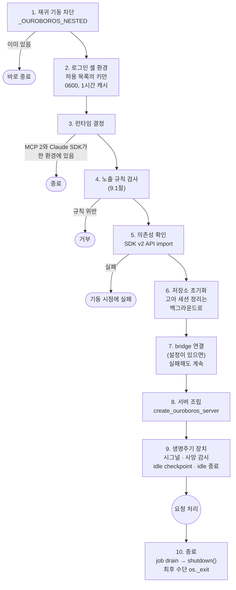

1. **재귀 기동 차단.** `_OUROBOROS_NESTED`가 있으면 바로 종료하고, 통과하면 이 값을 설정합니다(`src/ouroboros/cli/commands/mcp.py:1460-1464`, `:1501`).
2. **로그인 셸 환경 가져오기.** API 키·프록시 등 허용 목록의 키만 가져와 `~/.ouroboros/shell-env.json`에 0600으로 1시간 캐시합니다(`src/ouroboros/cli/commands/mcp.py:284-308`, `:325-332`).
3. **런타임 결정.** MCP 2와 Claude SDK가 같은 환경에 섞였으면 종료합니다. SDK 런타임이 기본으로 상속됐으면 PATH에서 `claude`/`codex`/`opencode`를 찾아 대체합니다(`src/ouroboros/cli/commands/mcp.py:1479-1499`).
4. **노출 규칙 검사** (9절)를 한 뒤 `_run_mcp_server`를 실행합니다(`src/ouroboros/cli/commands/mcp.py:1505-1544`).
5. **의존성 확인.** SDK v2 API를 import해 봅니다. "기동은 됐는데 연결이 끊긴 서버"를 막기 위해서입니다(`src/ouroboros/cli/commands/mcp.py:743-760`).
6. **저장소와 정리 작업.** EventStore·BrownfieldStore를 초기화하고, 고아 세션 정리는 핸드셰이크를 늦추지 않도록 백그라운드로 미룹니다(`src/ouroboros/cli/commands/mcp.py:821-881`).
7. **bridge.** 설정이 있으면 외부 MCP 서버에 연결합니다. 서버를 조립하기 전에 연결을 기다리므로, 상류 서버가 느리면 기동도 늦어집니다. 일부나 전부가 실패해도 기동은 계속하고 `N/M upstream server(s) connected`만 출력합니다(`src/ouroboros/cli/commands/mcp.py:883-897`). 자세한 것은 10.4절입니다.
8. **서버 조립.** `create_ouroboros_server(...)`(`src/ouroboros/cli/commands/mcp.py:921-929`)가 모든 핸들러와 서비스를 만드는 composition root입니다(`src/ouroboros/mcp/server/adapter.py:1498-2612`).
9. **생명주기 장치.** 시그널 핸들러, 클라이언트 사망 감시(watchdog), idle WAL checkpoint, idle 종료를 띄웁니다(`src/ouroboros/cli/commands/mcp.py:999-1084`).
10. **종료.** 작업을 먼저 drain한 뒤 `server.shutdown()`을 부릅니다. 저장소를 닫은 뒤에 작업이 죽으면 RUNNING 상태의 좀비 행이 남기 때문입니다(`src/ouroboros/cli/commands/mcp.py:1165-1191`). 마지막 수단으로 `os._exit`가 있습니다(`src/ouroboros/cli/commands/mcp.py:663-678`).

---

## 3. 요청 한 번의 경로: `tools/call`

**그림 3. `tools/call` 한 번.** 아래 표의 1~6단계를 시간 순서로 그렸습니다. 핸들러 예외를 잡는 곳이 adapter 한 곳뿐이라는 점(노란 메모)을 5절의 오류 모델과 함께 봅니다.

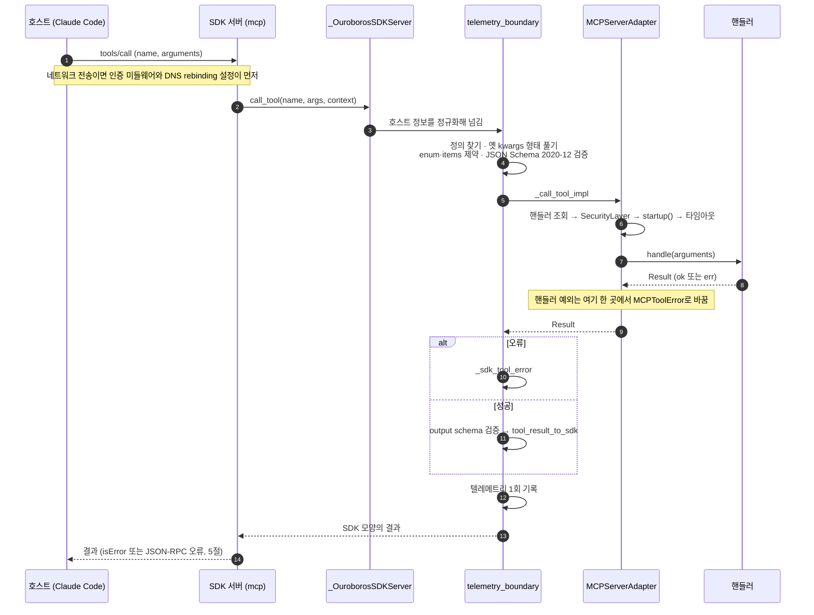

| 단계 | 하는 일 | 근거 |
|---|---|---|
| 1. 전송 (SDK) | 네트워크 전송이면 SDK 인증 미들웨어가 토큰을 검증하고 DNS rebinding 설정을 적용 | `src/ouroboros/mcp/server/auth.py:193-245`, `:312-385` |
| 2. SDK 서버 | `_handle_call_tool`이 `self.call_tool(name, args, context)`를 부름 | (2.3.0 기준, 저장소 루트의 `.venv`) `.venv/lib/python3.13/site-packages/mcp/server/mcpserver/server.py:221-223` |
| 3. SDK 경계 | `_OuroborosSDKServer.call_tool`이 호스트 정보를 정규화해 넘김 | `src/ouroboros/mcp/server/adapter.py:114-127` |
| 4. 검증 경계 | 정의를 찾고, 예전 `{"kwargs": {...}}` 형태를 풀고, enum·items 제약과 JSON Schema 2020-12로 입력을 검증 | `src/ouroboros/mcp/telemetry_boundary.py:298-309`, `src/ouroboros/mcp/server/adapter.py:506-546` |
| 5. adapter | 핸들러 조회 → `SecurityLayer.check_request` → `startup()` → `TIMEOUT_SECONDS`가 있으면 `wait_for` → `handler.handle(arguments)` → 예외는 `MCPToolError`로 | `src/ouroboros/mcp/server/adapter.py:863-1000` |
| 6. 돌아오는 길 | 오류는 `_sdk_tool_error`로, 성공은 output schema 검증 후 `tool_result_to_sdk`로 변환. 텔레메트리 1회 기록 | `src/ouroboros/mcp/telemetry_boundary.py:322-346`, `src/ouroboros/mcp/sdk_mapping.py:269-277` |

**스키마를 서버가 직접 소유합니다.** 보통 SDK는 Python 함수의 시그니처에서 입력 스키마를 추론합니다. Ouroboros는 그 추론이 `$defs`, 조합 키워드, output schema를 잃는다고 보고, `list_tools`를 오버라이드해 손으로 쓴 정의를 그대로 내보냅니다(`src/ouroboros/mcp/server/adapter.py:95-112`, `src/ouroboros/mcp/sdk_mapping.py:106-122`). 그리고 SDK가 검증해 주지 않는 부분을 4단계에서 다시 검증합니다.

**대가도 있습니다.** SDK 내부 등록용으로 `.tool()` 시그니처를 따로 합성하는 경로가 하나 더 있습니다(`src/ouroboros/mcp/server/adapter.py:357-465`, `:1145-1238`). 두 스키마를 맞추는 코드까지 있을 정도로 복잡합니다(`src/ouroboros/mcp/server/adapter.py:419-427`). 작은 서버라면 SDK의 추론을 그대로 쓰는 편이 낫습니다(14절).

---

## 4. 도구

### 4.1 도구를 정의하는 법

- 도구 정의는 frozen dataclass `MCPToolDefinition`입니다. 필드는 name, description, parameters, input_schema, output_schema, title, execution, icons, annotations, meta입니다(`src/ouroboros/mcp/types.py:307-328`).
- 인자는 `MCPToolParameter`(name, type, description, required, default, enum, items, min/max_items)로 **손으로** 적습니다(`src/ouroboros/mcp/types.py:280-303`). `to_input_schema()`가 이것으로 JSON Schema를 만들고, `input_schema`를 직접 주면 그것이 우선합니다(`src/ouroboros/mcp/types.py:330-368`).
- description은 핸들러의 `definition` 속성 안에 문자열로 있습니다. 좋은 예는 "Use when / Do not use when / Result" 구조입니다(`src/ouroboros/mcp/tools/auto_handler.py:696-710`).

대표 정의 (유일하게 annotations와 output schema를 갖춘 도구, `src/ouroboros/mcp/tools/project_status_handler.py:44-85`에서 줄임):

```python
return MCPToolDefinition(
    name=_TOOL_NAME,
    title="Project status",
    description=("Resolve a project identity and rebuild its complete read-only run status ..."),
    parameters=(MCPToolParameter(name="project_dir", type=ToolInputType.STRING, required=False, ...), ...),
    output_schema=cast(JSONObject, ProjectRecord.model_json_schema(mode="serialization")),
    annotations={"readOnlyHint": True, "destructiveHint": False, "idempotentHint": True, "openWorldHint": False},
)
```

### 4.2 서버가 노출하는 도구 36개

- `create_ouroboros_server`의 `tool_handlers` 목록에 32개(`src/ouroboros/mcp/server/adapter.py:2417-2544`)가 있고, fan-out 조립(`create_fanout_wiring`, `src/ouroboros/mcp/server/adapter.py:2496`)이 interview, pm_interview, submit_fanout_results, fetch_artifact 4개를 더합니다(`src/ouroboros/mcp/tools/fanout_composition.py:81-106`).
- 조건 없이 모두 등록합니다(`src/ouroboros/mcp/server/adapter.py:2596-2598`). 실행 모드는 등록이 아니라 동작을 바꿉니다. 예를 들어 OpenCode plugin 모드에서는 Start* 도구가 `status=delegated_to_plugin`을 돌려줍니다(`src/ouroboros/mcp/tools/evolution_handlers.py:1650-1665`).
- 테스트가 고정한 32개짜리 목록(`tests/unit/mcp/tools/test_definitions.py:1866-1899`)은 서버 목록이 아니라 codex 같은 런타임의 내장 도구 집합입니다(`src/ouroboros/mcp/tools/definitions.py:459-654`).

성격 표기: R=읽기, W=상태 기록, X=LLM·에이전트 실행, BG=job으로 즉시 반환, D=되돌릴 수 없음

| 단계 | 도구 (`ouroboros_` 접두어 생략) | 성격 | 정의 |
|---|---|---|---|
| 요구사항 | `interview` (소크라테스식 인터뷰, 반복 호출) | X·W | `src/ouroboros/mcp/tools/authoring_handlers.py:1963` |
| | `pm_interview` (PM 인터뷰) | X·W | `src/ouroboros/mcp/tools/pm_handler.py:423` |
| | `brownfield` (기존 저장소 스캔·등록·조회) | R/W | `src/ouroboros/mcp/tools/brownfield_handler.py:95` |
| 명세 | `generate_seed` (인터뷰에서 불변 Seed 생성. 모호도가 높으면 `force` 없이는 거부) | X·W | `src/ouroboros/mcp/tools/authoring_handlers.py:1156` |
| 실행 | `execute_seed` / `start_execute_seed` | X / BG·X | `src/ouroboros/mcp/tools/execution_handlers.py:1057`, `:2412-2443` |
| | `cancel_execution` | W | `src/ouroboros/mcp/tools/job_handlers.py:627` |
| | `session_signal`, `session_signal_targets` (실행 중인 세션에 감사 기록이 남는 신호) | W / R | `src/ouroboros/mcp/tools/synapse_handler.py:77-180`, `:291` |
| 평가 | `evaluate` / `start_evaluate` (기계 검사 → 의미 평가 → 합의) | X / BG·X | `src/ouroboros/mcp/tools/evaluation_handlers.py:469`, `:1568-1600` |
| | `checklist_verify`, `measure_drift`, `qa` | X, R, X | `src/ouroboros/mcp/tools/evaluation_handlers.py:1338`, `:274`, `src/ouroboros/mcp/tools/qa.py:418` |
| 진화 | `evolve_step` / `start_evolve_step` (1세대) | X·W / BG·X | `src/ouroboros/mcp/tools/evolution_handlers.py:372-510`, `:1580` |
| | `ralph` / `start_ralph` (수렴까지 반복) | BG·X | `src/ouroboros/mcp/tools/ralph_handlers.py:85-255`, `:561-578` |
| | `evolve_rewind` (지정 세대로 되감고 뒤를 잘라냄) | **D**·W | `src/ouroboros/mcp/tools/evolution_handlers.py:1221` |
| | `lineage_status`, `ac_dashboard` | R | `src/ouroboros/mcp/tools/evolution_handlers.py:1403`, `src/ouroboros/mcp/tools/query_handlers.py:618` |
| 한 번에 | `auto` / `start_auto` (인터뷰 → Seed → 실행 전체) | X·W / BG·X·W | `src/ouroboros/mcp/tools/auto_handler.py:156-305`, `:694` |
| job | `job_status`, `job_wait`, `job_result`, `cancel_job` | R, R, R, W | `src/ouroboros/mcp/tools/job_handlers.py:1237`, `:1326-1384`, `:2047`, `:2164` |
| 조회 | `session_status`, `query_events`, `query_projection`, `project_status`, `ac_tree_hud` | R | `src/ouroboros/mcp/tools/query_handlers.py:73`, `:425`, `src/ouroboros/mcp/tools/projection_handlers.py:52`, `src/ouroboros/mcp/tools/project_status_handler.py:44`, `src/ouroboros/mcp/tools/ac_tree_hud_handler.py:1363` |
| 조율 | `record_conductor_decision` | W | `src/ouroboros/mcp/tools/conductor_handler.py:67-170` |
| 사고 보조 | `lateral_think` (페르소나별 대안) | X | `src/ouroboros/mcp/tools/lateral_think_handler.py:87-170` |
| fan-out | `submit_fanout_results`, `fetch_artifact` (호스트가 띄운 하위 에이전트 결과 제출·읽기) | W, R | `src/ouroboros/mcp/tools/fanout_handler.py:101-145`, `:298` |

### 4.3 도구끼리 이어지는 법

**그림 4. 도구 연결.** 화살표 위의 글자가 앞 도구의 결과에 들어 있다가 다음 도구의 인자가 되는 값입니다. 점선은 서버가 스스로 다음 job을 잇는 곳입니다.

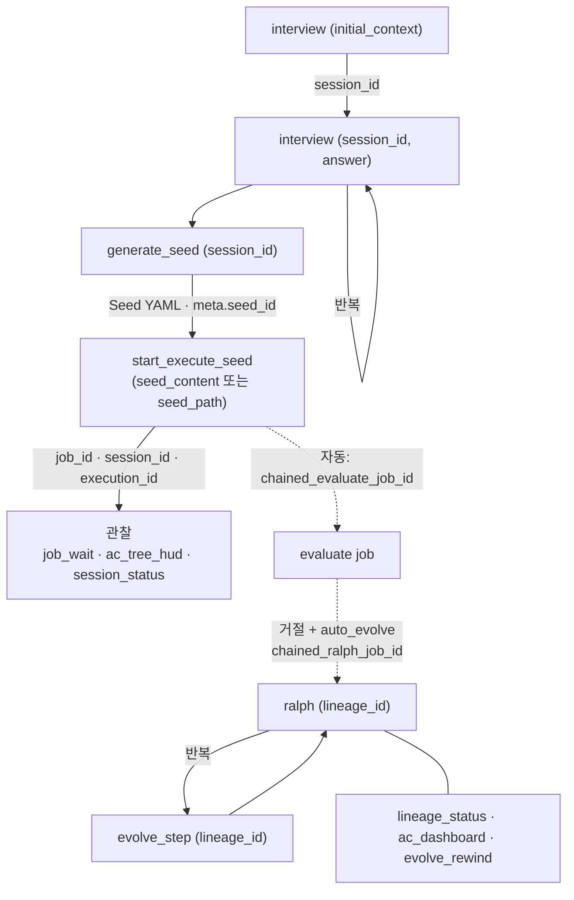

근거: `src/ouroboros/mcp/tools/authoring_handlers.py:1545-1561`(Seed 결과), `src/ouroboros/mcp/tools/execution_handlers.py:2829-2842`(실행 시작 결과), `src/ouroboros/mcp/tools/run_evaluate_chain.py:143-165`(평가 자동 연결), `src/ouroboros/mcp/tools/evaluate_ralph_chain.py:433`(Ralph 자동 연결), `src/ouroboros/mcp/tools/auto_handler.py:133`(auto가 따라가는 키).

**한 도구의 결과에 다음 도구를 부를 ID와 이름을 넣는 것**이 이 연결의 핵심입니다. Claude가 텍스트를 해석해 다음 할 일을 짐작하지 않게 합니다.

### 4.4 도구 정의에서 눈여겨볼 점

- **annotations는 36개 중 1개에만 있습니다**(`src/ouroboros/mcp/tools/project_status_handler.py:79-85`). 되돌릴 수 없는 `evolve_rewind`에도 힌트가 없습니다. 호스트는 대부분의 도구가 읽기 전용인지 파괴적인지 알 수 없습니다. **Challenge 기준(모든 도구에 네 개 모두)과 반대되는 예**입니다.
- **output schema도 1개뿐입니다**(`src/ouroboros/mcp/tools/project_status_handler.py:79`).
- **enum이 description에만 있는 인자가 있습니다.** `job_wait`의 `view`, `stream`, `wait_for` 같은 값은 스키마 enum이 아니어서 오타를 스키마 검증이 못 잡습니다(`src/ouroboros/mcp/tools/job_handlers.py:1246-1252`, `:1366-1384`).
- **동기·비동기 쌍이 다섯 개입니다**(auto, execute, evaluate, evolve, ralph). 모델이 어느 쪽을 고를지 헷갈릴 수 있습니다 (추정).
- **같은 이름의 도구는 경고 없이 덮어씁니다**(`src/ouroboros/mcp/server/adapter.py:772-773`). 같은 루프에서 채우는 `ToolRegistry`는 중복에 `ValueError`를 내지만(`src/ouroboros/mcp/tools/registry.py:72-76`), 그 레지스트리는 다시 읽히지 않습니다.

---

## 5. 오류 모델

### 5.1 세 채널

| 채널 | 언제 | 호스트에 보이는 모양 | 근거 |
|---|---|---|---|
| **업무 결과로서의 실패** | job 결과가 실패, 실행 전 취소 등 | `Result.ok(MCPToolResult(is_error=True))` → `isError: true` | `src/ouroboros/mcp/types.py:371-389`, `src/ouroboros/mcp/tools/job_handlers.py:1190-1196`, `src/ouroboros/mcp/tools/background.py:107-120` |
| **예상된 거부** | 입력이나 업무 규칙 위반 | `Result.err(MCPToolError(...))`. `error_code`가 있으면 JSON-RPC 오류(`-32603`, `data={error_code, details}`), 없으면 `isError: true` 결과 | `src/ouroboros/mcp/errors.py:342-382`, `src/ouroboros/mcp/telemetry_boundary.py:238-267` |
| **그 밖의 모든 실패** | 도구 없음, 인자 검증 실패, 보안 거부, 핸들러 예외, 타임아웃, output schema 불일치 | `isError: true` 텍스트 결과 (2.3.0 기준 SDK 변환) | `src/ouroboros/mcp/server/adapter.py:892-1000` |

**그림 5. 오류 세 채널.** 핸들러가 무엇을 돌려주느냐에 따라 호스트가 보는 모양이 갈립니다. 채널 2의 `error_code`가 있는 경우만 JSON-RPC 오류로 나갑니다.

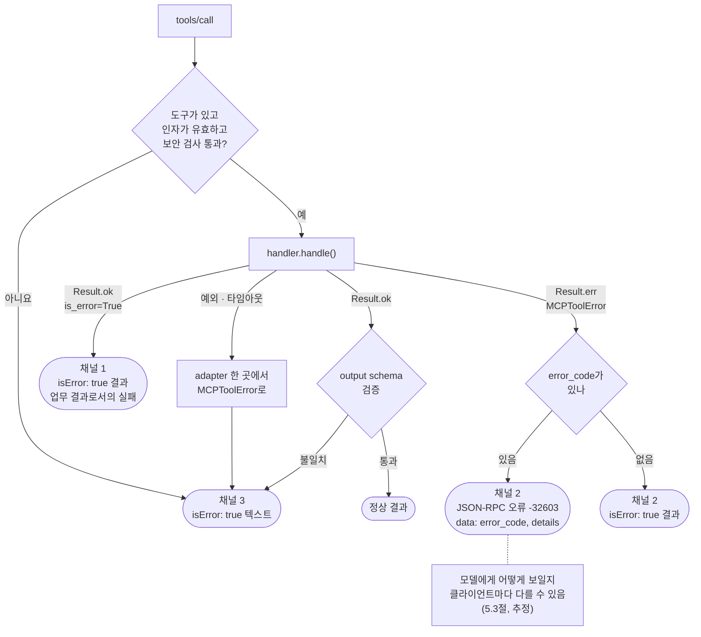

- 예외는 adapter의 `_call_tool_impl` **한 곳에서만** 잡아 바꿉니다(`src/ouroboros/mcp/server/adapter.py:930-1000`). 핸들러는 예상된 실패를 `Result`로 돌려줍니다.
- 백그라운드 작업이 실패하면 runner가 `JobWorkError`를 던지고, JobManager가 `mcp.job.failed` 이벤트에 **정해진 어휘**의 meta만 붙여 저장합니다(`src/ouroboros/mcp/tools/background.py:386-412`, `src/ouroboros/mcp/errors.py:390-404`).

### 5.2 실패 분류는 텍스트를 읽지 않습니다

`failure_taxonomy.py`는 오류 메시지가 아니라 종료 상태와 메타데이터 키만 보고 `FailureReasonCode` 8종 중 하나로 분류하고, `RecoveryAction` 6종과 고정된 안내 문구를 붙입니다(`src/ouroboros/mcp/failure_taxonomy.py:1-7`, `:16-26`, `:72-80`, `:119-152`, `:181-221`). JobManager가 이 값을 결과 meta의 `failure_reason_code`, `recovery_action`, `next_step`에 채웁니다(`src/ouroboros/mcp/job_manager.py:104-128`).

### 5.3 주의할 점

`error_code`가 있는 업무 오류는 JSON-RPC 오류로 나갑니다. 클라이언트가 이것을 모델에게 도구 결과로 보여 주는지, 호출 실패로 처리하는지는 클라이언트마다 다를 수 있습니다 (추정). Challenge 예시 서버가 업무 오류를 **언제나** `success:false` 값으로 돌려주게 한 이유가 이것입니다(`Day04_new/use_cc/challenge/examples/example-tasks/server/server.py`의 관례 1).

---

## 6. 오래 걸리는 작업: job 모델

### 6.1 다섯 도구로 나눕니다

시작(`start_*`) → 상태(`job_status`) → 기다리기(`job_wait`) → 결과(`job_result`) → 취소(`cancel_job`). 시작 결과에는 `job_id`와 함께 **다음에 부를 도구 이름**(`status_tool`, `wait_tool`, `result_tool`)이 들어 있습니다(`src/ouroboros/mcp/tools/auto_handler.py:991-1005`).

### 6.2 시작에서 끝까지

1. **ID 예약.** `job_{uuid4().hex[:12]}`(`src/ouroboros/mcp/job_manager.py:508-525`).
2. **어디서 돌릴지.** `durable_jobs`(serve의 기본값 True, `src/ouroboros/mcp/server/adapter.py:1514`)이고 EventStore가 SQLite 파일이면 **detached** 경로로 갑니다(`src/ouroboros/mcp/tools/background.py:225-228`).
3. **detached 경로.**
   - 요청을 `~/.ouroboros/detached-jobs/{job_id}.json`에 0600, 배타적 생성으로 씁니다(`src/ouroboros/mcp/detached_jobs.py:127-161`).
   - `python -m ouroboros.mcp.detached_worker <경로>`를 새 세션, stdio DEVNULL로 띄웁니다(`src/ouroboros/mcp/detached_jobs.py:282-300`).
   - 부모는 최대 20초 동안 `mcp.job.created` 이벤트를 기다립니다(`src/ouroboros/mcp/detached_jobs.py:33`, `:361-431`). 시간을 넘겨도 worker를 죽이지 않고 `acceptance_pending` 영수증을 돌려줍니다. 영수증에는 `retry_start_allowed: False`와 확인용 호출이 들어 있어, 같은 작업이 두 번 시작되지 않게 합니다(`src/ouroboros/mcp/detached_jobs.py:98-120`).
4. **detached worker.** 요청 파일을 읽자마자 지우고(`src/ouroboros/mcp/detached_worker.py:36-42`), **같은 서버를 다시 조립해 같은 Start 핸들러로 들어가** 부모가 예약한 ID를 소비합니다(`src/ouroboros/mcp/detached_worker.py:186-205`). 종료 이벤트가 생길 때까지 살아 있습니다(`src/ouroboros/mcp/detached_worker.py:251-253`).
5. **inline 경로.** `start_managed_job`이 `mcp.job.created` 이벤트를 남긴 뒤 runner와 감시 태스크를 만듭니다(`src/ouroboros/mcp/job_start.py:44-149`). 시작 전에 취소됐는지 확인합니다(`src/ouroboros/mcp/tools/background.py:327-342`).
6. **종료.** running으로 바꾼 뒤 종료 이벤트를 쓰고(결과 텍스트 20,000자 상한), 종료 이벤트를 끝까지 보장하는 백스톱 태스크가 따로 있습니다(`src/ouroboros/mcp/job_manager.py:584-718`, `:739-775`).

**그림 6. detached 경로.** 위 2~4단계와 그 뒤의 관찰을 시간 순서로 그렸습니다. 호스트는 시작 뒤 `job_wait`를 여러 번 부르고, worker는 별도 프로세스에서 끝까지 갑니다.

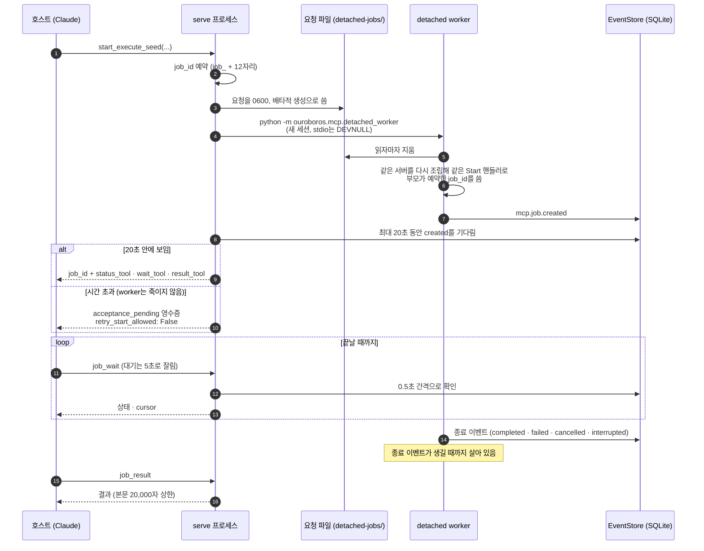

**그림 7. job 상태.** 상태 값은 7개이고 그중 4개가 종료 상태입니다(`src/ouroboros/mcp/job_snapshot.py:24-33`, `:63-70`). 전이 규칙표가 코드에 따로 있지는 않습니다. 그림은 `job_manager.py`에서 상태를 쓰는 곳을 모아 그린 주요 경로입니다. ID 예약부터 `queued` 전까지(요청 파일, worker 기동, `acceptance_pending` 영수증)는 상태 값이 아니라 그림 6의 단계입니다.

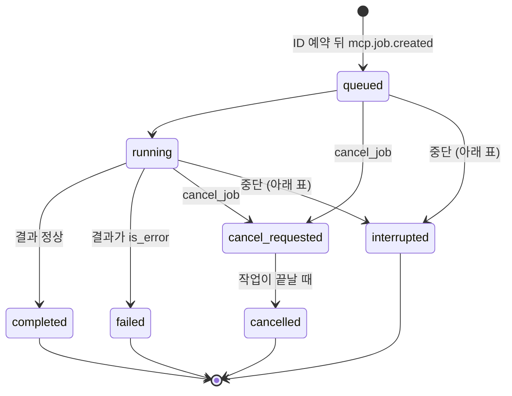

| 전이 | 언제 | 근거 |
|---|---|---|
| `running` → `completed` / `failed` / `cancelled` | 작업이 끝날 때 하나를 고름. `cancel_requested`였으면 `cancelled`, 결과가 `is_error`면 `failed` | `src/ouroboros/mcp/job_manager.py:668-686` |
| → `cancel_requested` | `cancel_job`. 이미 종료 상태면 그대로 둠 | `src/ouroboros/mcp/job_manager.py:2355-2358`, `:2406` |
| → `interrupted` (서버 종료) | 서버가 종료하며 남은 job을 정리(drain) | `src/ouroboros/mcp/job_manager.py:170-176` |
| → `interrupted` (소유자 사망) | 소유 프로세스가 죽은 좀비 job | `src/ouroboros/mcp/job_manager.py:314-330` |
| → `interrupted` (종료 이벤트 없음) | 작업 태스크가 종료 이벤트를 남기지 않고 끝남 | `src/ouroboros/mcp/job_manager.py:334-342` |

### 6.3 왜 detached인가

**stdio 서버 안의 asyncio 태스크는 클라이언트 턴과 함께 죽습니다**(`src/ouroboros/mcp/detached_jobs.py:1-7`). 몇 분짜리 실행을 서버 프로세스 안에서 돌리면, 사용자가 세션을 닫거나 클라이언트가 서버를 다시 띄우는 순간 작업이 사라집니다. 그래서 별도 프로세스로 떼어 내고 상태를 이벤트 저장소에 남깁니다. 그런데도 동기 도구 `execute_seed`는 job 없이 서버 안에서 바로 `create_task`를 합니다(`src/ouroboros/mcp/tools/execution_handlers.py:1991-1996`).

### 6.4 관찰하는 쪽을 위한 장치

- **상태는 이벤트로 저장합니다.** job 상태는 EventStore에 `aggregate_type="job"` 이벤트로 쌓이고(`src/ouroboros/mcp/job_manager.py:2893-2915`), 스냅샷은 이벤트를 접어 만들며 cursor는 rowid입니다(`src/ouroboros/mcp/job_snapshot.py:106-165`).
- **long-poll은 짧게.** `job_wait`는 대기 시간을 5초로 자르고 0.5초 간격으로 확인합니다(`src/ouroboros/mcp/tools/job_handlers.py:61`, `:1423`, `src/ouroboros/mcp/job_manager.py:2307-2328`).
- **관찰 계약.** `ouroboros.job_observer.v1` 계약에 미리 채운 `job_wait`·`job_result` 호출 인자를 넣습니다(`src/ouroboros/mcp/tools/job_observer.py:27-76`). meta를 못 보는 텍스트 전용 호스트를 위해 같은 내용을 base64 HTML 주석으로 본문에 덧붙입니다(`src/ouroboros/mcp/tools/job_observer.py:12-13`, `:221-233`).
- **취소.** `cancel_job`은 CheckpointStore에 `mcp_job:{job_id}` 취소 표시를 남기고 상태를 CANCEL_REQUESTED로 바꿉니다(`src/ouroboros/mcp/job_manager.py:2663-2679`, `:2406`). 다른 프로세스의 worker는 이 표시를 보고 취소를 알아챈다고 봅니다 (추정, `src/ouroboros/mcp/tools/background.py:18-25`).
- **어긋난 곳.** 관찰 계약은 `timeout_seconds: 180`을 권하지만(`src/ouroboros/mcp/tools/job_observer.py:66`) 서버는 5초로 자릅니다(`src/ouroboros/mcp/tools/job_handlers.py:1423`).

---

## 7. 중복 호출 방지와 소유권

| 장치 | 범위 | 막는 문제 | 근거 |
|---|---|---|---|
| `idempotency_key` (`start_execute_seed`) | 프로세스 메모리. 재시작하면 사라짐 | 타임아웃 뒤 재시도로 실행이 두 번 들어가는 것 | `src/ouroboros/mcp/tools/execution_handlers.py:2357-2408` |
| `start_auto` lease | `~/.ouroboros/data/{auto_session_id}.start_auto_lease.json`, 파일 잠금, 대기 TTL 60초, 소유자 생존 확인 | 같은 auto 세션의 동시 시작, 부모 → worker 소유권 이전 순간의 공백 | `src/ouroboros/mcp/tools/auto_handler.py:1325-1400`, `src/ouroboros/mcp/tools/auto_start_lease_store.py:12-65` |
| 활성 job 검사 | 세션·계보별로 이미 도는 job 찾기 | 같은 세션 재개 중복, Ralph 후속 job 중복 | `src/ouroboros/mcp/tools/auto_handler.py:1056-1084`, `src/ouroboros/mcp/tools/evaluate_ralph_chain.py:238-247` |
| evolve start claim | 세대 claim이 저장될 때까지 작업을 붙잡고, 1초 안에 없으면 재시도 가능한 `evolve_lineage_busy` | 같은 계보에 기록자가 둘 생기는 것 | `src/ouroboros/mcp/tools/evolve_start_claim.py:17-107` |
| evolve 영수증 | 인자를 정규화한 해시(`request_key`)로 한 번만 실행. 같은 키로 끝난 것이 있으면 저장된 영수증을 돌려줌 | 다른 프로세스에서 같은 세대를 재시도할 때 실행·QA를 다시 돌리는 것 | `src/ouroboros/mcp/tools/evolve_handler_receipt.py:13-93` |
| `decision_id` | 이벤트를 다시 읽어 같은 결과면 그대로, 다른 결과면 오류 | 서로 모순되는 감사 기록 | `src/ouroboros/mcp/tools/conductor_handler.py:182-205` |
| 결정적 이벤트 ID | 복구·중단 이벤트 ID에 고정 접두어 | 정리 작업을 여러 번 해도 종료 이벤트가 하나만 남음 | `src/ouroboros/mcp/job_manager.py:157-162` |

**그림 8. 중복 호출 방지.** 왼쪽 실패 하나마다 장치 하나가 짝지어지고, 오른쪽이 그 장치의 기억이 남는 곳입니다. 기억이 오래 가는 곳일수록(프로세스 메모리 → 파일 → 이벤트 저장소) 프로세스를 넘는 실패까지 막습니다.

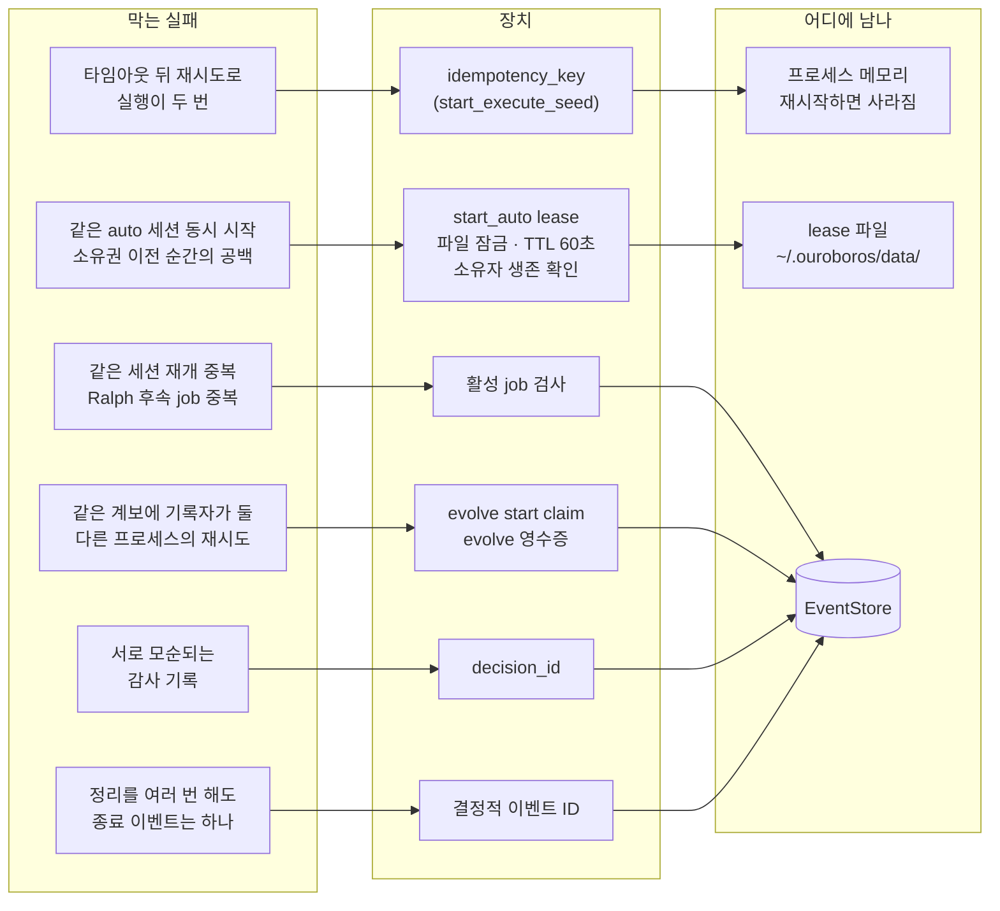

메모리 키, 파일 lease, 이벤트 저장소의 claim과 영수증으로 **세 겹**입니다. 각 장치가 어느 실패(타임아웃 재시도, 동시 시작, 프로세스를 넘는 재시도)를 막는지 짝이 분명합니다.

---

## 8. 상태와 저장소, 리소스

- **EventStore.** 단일 `events` 테이블에 append-only로 쓰는 SQLite입니다(`docs/architecture.md:459-476`). 코드의 기본 경로는 `~/.ouroboros/ouroboros.db`입니다(`src/ouroboros/config/models.py:947-950`, `:972-974`). 문서는 새 설치 기본값을 `~/.ouroboros/data/ouroboros.db`로 적지만, 이것은 설정 파일에 그 값이 있을 때만 맞습니다(`docs/config-reference.md:16-29`).
- **생명주기.** `ServerResourceLifecycle`은 리소스를 startup 전에만 등록받고, startup을 한 번만 실행하며, 실패하면 그 오류를 기억해 다시 던집니다(`src/ouroboros/mcp/server/resource_lifecycle.py:28-67`). 소유 순서는 ControlBus → EventStore → BrownfieldStore → MCP bridge입니다(`src/ouroboros/mcp/server/adapter.py:2569-2593`). `startup()`은 모든 도구 호출마다 불립니다(`src/ouroboros/mcp/server/adapter.py:931`).
- **리소스 4종.** 내용은 모두 `application/json` 텍스트이고 `sort_keys=True`로 순서가 늘 같습니다(`src/ouroboros/mcp/resources/handlers.py:131-135`).

| URI | 내용 | 근거 |
|---|---|---|
| `ouroboros://seeds`, `ouroboros://seeds/{id}` | `~/.ouroboros/seeds`의 Seed 요약과 전체 | `src/ouroboros/mcp/resources/handlers.py:95-158` |
| `ouroboros://sessions`, `…/current`, `…/{id}` | 이벤트로 다시 구성한 세션. `current`는 running/paused 중 가장 최근 것 | `src/ouroboros/mcp/resources/handlers.py:239-310` |
| `ouroboros://events`, `…/{session_id}` | 최근 이벤트 100건. 비밀값(토큰, Bearer, `sk-`, `ghp_` 등)을 가림 | `src/ouroboros/mcp/resources/handlers.py:411-575` |

- 구간이 하나뿐인 base URI(`scheme://name`)에는 `{resource_id}` 템플릿을 자동으로 추가합니다(`src/ouroboros/mcp/server/adapter.py:1241-1308`).
- **프롬프트는 없습니다.** 등록 경로는 있지만 `register_prompt`를 부르는 곳이 없어 prompts capability가 꺼집니다 **[정의만]**(`src/ouroboros/mcp/server/adapter.py:756`, `:1310-1342`).

---

## 9. 보안 경계

### 9.1 노출 규칙은 기본이 닫힘

- **stdio**에서는 인증을 설정하면 거부합니다(`src/ouroboros/mcp/server/auth.py:461-467`). 기본 `AuthMethod.NONE`은 모든 권한을 줍니다(`src/ouroboros/mcp/server/security.py:207-215`).
- **네트워크 전송**
  - loopback 바인드는 자격 증명 없이 허용합니다.
  - 그 밖의 주소는 `--auth-token`과 `--allow-remote`가 모두 필요하고, 와일드카드 바인드는 `--allowed-host`도 필요합니다(`src/ouroboros/cli/commands/mcp.py:1269-1300`).
  - 같은 규칙을 adapter의 `serve()`가 한 번 더 강제합니다(`src/ouroboros/mcp/server/auth.py:479-486`). CLI는 친절한 안내를, adapter는 서버를 코드로 띄우는 쪽도 우회하지 못하는 경계를 맡습니다(`src/ouroboros/cli/commands/mcp.py:1237-1239`).
  - DNS rebinding 보호는 항상 켜고, Origin 허용 목록은 기본이 비어 있어 브라우저 요청을 모두 거부합니다(`src/ouroboros/mcp/server/auth.py:381-385`).
- 토큰은 sha256 해시로 비교합니다(`src/ouroboros/mcp/server/security.py:185-193`, `:260-261`).

**그림 9. 노출 규칙.** 위에서부터 질문에 답해 내려가면 서버가 뜨는지 거부되는지 나옵니다. 같은 규칙을 CLI와 adapter의 `serve()`가 두 번 강제합니다.

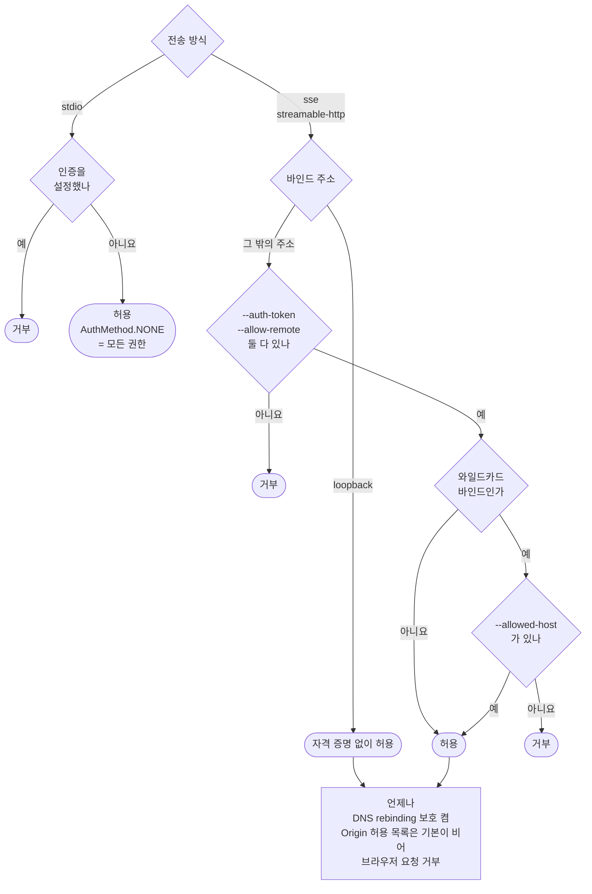

### 9.2 실행 제한은 기본이 열림

- rate limit은 기본으로 꺼져 있습니다(`src/ouroboros/mcp/server/security.py:75`).
- 도구별 권한을 등록하는 코드가 없어 인증만 되면 모든 도구를 쓸 수 있습니다(`src/ouroboros/mcp/server/security.py:404-407`).
- `--workspace-root`로 작업 폴더를 제한할 수 있지만 기본은 비어 있어 모두 허용하고(`src/ouroboros/mcp/server/workspace.py:15-16`, `:69-70`), 실제로 검사하는 곳은 Seed 실행 경로 하나입니다(`src/ouroboros/mcp/tools/execution_handlers.py:2179-2190`).
- `InputValidator`는 자유 텍스트가 아닌 문자열에서 `__import__`, `subprocess`, `../`, `;` 같은 패턴을 거부합니다. 자유 텍스트 면제는 **필드 이름**으로 정합니다(`src/ouroboros/mcp/server/security.py:447-483`, `:518-613`). 샌드박스가 아니라 문자열 차단이라 우회도 오탐도 가능합니다.

### 9.3 프로젝트 폴더는 cwd로 정합니다

`CLAUDE_PROJECT_DIR`은 src 어디에서도 쓰지 않습니다. 서버를 띄운 프로세스의 cwd를 프로젝트 폴더로 보고, cwd가 `/`이거나 쓰기 불가면 `$HOME`으로 물러납니다(`src/ouroboros/mcp/server/adapter.py:226-236`). Claude Code가 프로젝트 폴더에서 서버를 띄운다고 가정하는 셈입니다 (추정). Challenge 예시 plugin은 반대로 `${CLAUDE_PROJECT_DIR}`를 명시적으로 받습니다.

### 9.4 신뢰 경계를 주석과 차단 목록으로

- bridge 설정은 `OUROBOROS_MCP_CONFIG`와 `~/.ouroboros/mcp_servers.yaml`만 읽습니다. **프로젝트 폴더의 설정은 일부러 읽지 않습니다.** 클론한 저장소가 설정의 `command`를 심으면 원격 코드 실행이 되기 때문입니다(`src/ouroboros/mcp/bridge/config.py:31-45`).
- 같은 이유로 신뢰할 수 없는 저장소의 `.env`에서 `OUROBOROS_MCP_CONFIG`를 지웁니다(`src/ouroboros/config/untrusted_env.py:142-155`).
- MCP 클라이언트의 HTTP URL은 SSRF 검사를 거칩니다. http/https만 허용하고, userinfo를 거부하고, loopback·사설망·link-local을 막고, 리다이렉트를 따라가지 않습니다(`src/ouroboros/mcp/types.py:94-135`, `src/ouroboros/mcp/client/sdk_factory.py:65-72`).

### 9.5 기계 밖으로 나가는 것

- **익명 텔레메트리(PostHog)가 기본으로 켜져 있습니다**(`src/ouroboros/config/loader.py:1556-1559`, `src/ouroboros/telemetry.py:49`). `DO_NOT_TRACK=1`, `OUROBOROS_TELEMETRY=0` 등으로 끕니다(`src/ouroboros/telemetry.py:11-12`).
- 텔레메트리 경계는 호출자가 통제할 수 있는 문자열이 새지 않게 합니다. 등록되지 않은 도구 이름은 `ouroboros_unknown_tool`로, 허용 목록에 없는 오류 클래스는 `ExtensionError`로 바꿉니다(`src/ouroboros/mcp/telemetry_boundary.py:38-132`).
- serve 기동 때 PyPI 버전을 확인합니다(`src/ouroboros/mcp/update_notice.py:9-16`).
- 로컬 로그에는 인자의 **키 이름만** 남깁니다(`src/ouroboros/mcp/server/adapter.py:885-891`).

---

## 10. MCP 클라이언트로서의 Ouroboros

### 10.1 누구에게 붙나

| 상대 | 용도 | 근거 |
|---|---|---|
| `codex mcp-server` | Codex를 작업자 풀로. `codex` 도구로 세션을 시작하고 `codex-reply`로 이어 감 | `src/ouroboros/orchestrator/codex_mcp_runtime.py:1-9`, `:135-151` |
| `gjc mcp-serve coordinator` | GJC 세션 수명주기 | `src/ouroboros/gjc/sdk_client.py:1-5`, `:262-406` |
| 사용자 외부 MCP 서버 (bridge) | 외부 도구의 **이름**을 실행 세션의 허용 도구 목록과 정책 카탈로그에 합침. 호출은 중계하지 않음(10.4절) | `src/ouroboros/mcp/bridge/bridge.py:18-31`, `src/ouroboros/cli/commands/mcp.py:883-897` |
| 같은 형식의 YAML (`ouroboros run --mcp-config`) | CLI 실행 모드에서 위와 같은 일. 단 YAML의 `tool_prefix`는 버리고 `--mcp-tool-prefix` 옵션을 쓰며, 하나도 연결되지 않으면 manager 없이 진행 | `src/ouroboros/cli/commands/run.py:532-591`, `:998-1004` |

다른 에이전트 CLI를 **MCP 서버로 띄워 원격 조종하는 것**이 외부 도구를 쓰는 것보다 더 무거운 용도입니다(`src/ouroboros/orchestrator/adapter.py:776`, `:804-805`).

### 10.2 클라이언트 구조

- **네 파일로 나눕니다.**
  - `protocol.py`: `MCPClient` Protocol. 모든 메서드가 `Result`를 돌려줍니다(`src/ouroboros/mcp/client/protocol.py:27-35`).
  - `sdk_factory.py`: 설정을 SDK `Client`로 번역만 합니다(`src/ouroboros/mcp/client/sdk_factory.py:1-6`).
  - `adapter.py`: 연결 하나. DTO 변환, 재시도, 자원 정리(`src/ouroboros/mcp/client/adapter.py:1-6`).
  - `manager.py`: 여러 서버. 상태 머신, 세대(generation) 번호, 도구 캐시(`src/ouroboros/mcp/client/manager.py:37-44`).
- **lock 안에서는 상태만 바꾸고 I/O는 밖에서** 하며, 결과를 반영할 때 세대 번호를 다시 비교해 그 사이 끼어든 시도의 결과를 버립니다(`src/ouroboros/mcp/client/manager.py:286-377`).
- **반복해도 안전한 것만 다시 보냅니다.** transport가 끊긴 것 같으면 재연결하되, 도구 호출은 원래 오류를 그대로 돌려주고 다시 보내지 않습니다(`src/ouroboros/mcp/client/manager.py:561-572`). 리소스 읽기는 재연결 뒤 한 번 더 읽습니다(`src/ouroboros/mcp/client/manager.py:650-657`).
- **anyio 연결은 actor 하나에 가둡니다.** 연결을 연 태스크가 닫기까지 맡고 다른 태스크는 queue로 요청합니다(`src/ouroboros/orchestrator/codex_mcp_session_pool.py:8-19`, `:62-88`).

### 10.3 자식 런타임에게서 자기 자신을 끕니다

자식 CLI는 사용자 홈의 MCP 설정을 그대로 물려받습니다. 거기에는 Ouroboros 자신도 들어 있어, 자식이 Ouroboros 도구를 부르면 오케스트레이터에 다시 들어오게 됩니다. 그래서 여러 겹으로 막습니다.

- `claude -p` 워커: `--disallowedTools "mcp__ouroboros mcp__plugin_ouroboros_ouroboros"`(`src/ouroboros/orchestrator/claude_worker_runtime.py:48-58`)
- Codex 워커: `config.mcp_servers.ouroboros.enabled=false`(`src/ouroboros/orchestrator/codex_mcp_runtime.py:67-76`)
- 인터뷰용 Claude LLM 어댑터: `--strict-mcp-config --setting-sources ""`(`src/ouroboros/providers/claude_code_adapter.py:708-716`)
- 공통: 런타임 환경 변수를 지우고 `_OUROBOROS_DEPTH`를 올리며, 5를 넘으면 예외(`src/ouroboros/runtime/child_env.py:31-36`, `:67-84`)

**그림 10. 클라이언트로서 붙는 곳.** 실선은 Ouroboros가 직접 부리는 상대이고, 상자 안의 "막음"이 그 자식이 Ouroboros를 다시 부르지 못하게 하는 장치입니다. 점선(bridge)은 10.4절에서 따로 봅니다.

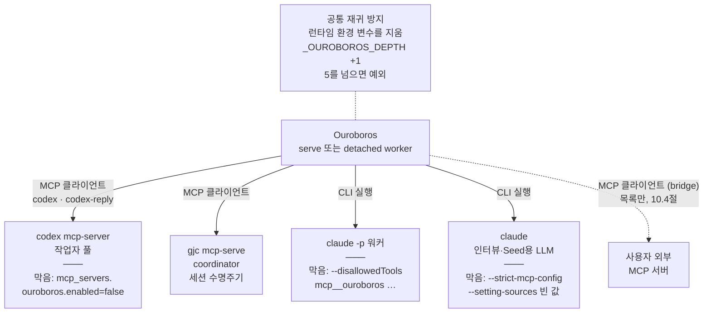

### 10.4 bridge: 연결과 목록까지, 호출은 없습니다

**결론.** bridge는 외부 MCP 서버에 연결해 도구 목록을 받고, 그 **이름**을 실행 세션의 허용 도구 목록, 정책 카탈로그, 이벤트에 넣습니다. 그러나 작업자(자식 런타임)가 그 도구를 실제로 부르게 하는 경로는 없습니다. 게다가 Claude Code plugin의 기본 흐름(`ouroboros_start_execute_seed`)은 bridge가 없는 별도 프로세스에서 실행돼, 이름조차 찾지 않습니다. 문서는 "자식 에이전트가 상류 MCP 도구를 모두 쓸 수 있다"고 적고(`docs/guides/mcp-bridge.md:56-58`), 그림에도 "Child Agent (native + external tools)"라고 그립니다(`docs/guides/mcp-bridge.md:22-24`). 코드는 그렇지 않습니다.

**그림 11. bridge가 닿는 곳과 끊긴 곳.** 실선이 실제로 이어진 길, 끝이 ×인 점선이 **없는** 길입니다. 붉은 점선 상자는 plugin 기본 흐름에서 bridge가 사라지는 곳입니다(10.4.5절).

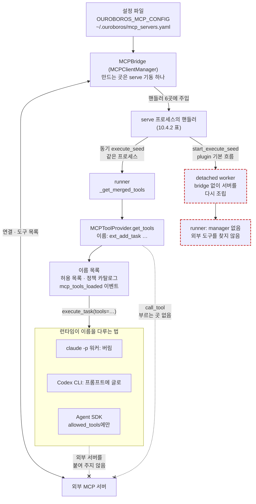

**확인 방법.** 호출을 따라간 뒤, 2026-11-04에 저장소 밖 임시 폴더의 복사본에서 실제로 실행했습니다. 조건은 다음과 같습니다.

- 서버가 고정한 `mcp==2.0.0`과 런타임 의존성만 깐 venv를 썼습니다.
- HOME은 임시 폴더로 바꾸고, 텔레메트리는 `OUROBOROS_TELEMETRY=0`, `DO_NOT_TRACK=1`로 껐습니다.
- 상류 서버는 Challenge 예시 서버(`Day04_new/use_cc/challenge/examples/example-tasks`)이고, `tool_prefix: ext_`를 줬습니다.
- 모델은 부르지 않았습니다. 그래서 seed 실행 자체는 돌리지 않고, 그 직전까지의 조립과 도구 목록 단계만 실행했습니다.

출력은 아래와 같고, 본문의 "실측 A1" 같은 표시가 이 줄입니다. 실험 스크립트는 저장소에 넣지 않았습니다.

```
A0 discover_config: <임시 HOME>/bridge.yaml          (OUROBOROS_MCP_CONFIG로 지정)
A1 connect: {'tasks': 'ok'}
A2 upstream tools: ['add_task', 'list_tasks', 'complete_task']
A3 health check task after connect: None
B1 provider names: ['ext_add_task', 'ext_complete_task', 'ext_list_tasks']
B2 provider.call_tool(list_tasks): ok, is_error= False text= {"success": true, "count": 0, "tasks": []}
C1 serve composition: {'ouroboros_execute_seed': True, 'ouroboros_start_execute_seed.execute_handler': True,
   'ouroboros_auto': True, 'ouroboros_start_auto': True, 'ouroboros_lateral_think': True, 'ouroboros_evolve_step': True}
C2 start_execute_seed detaches? durable_jobs_enabled= True supports_cross_process_workers= True claude_mcp requires in-process= False
D1 detached-worker composition: (위 여섯 곳 모두 False)
E0 runtime: LeaderDrivenWorkerRuntime tool_restriction_support= ignored
E1 merged tools: ['Read', 'Write', 'Edit', 'Bash', 'Glob', 'Grep', 'ext_add_task', 'ext_complete_task', 'ext_list_tasks']
E2 provider returned to caller: MCPToolProvider
F1 codex composed prompt: <tooling-guidance> Prefer to solve the task using the following tool set when possible: - Read - ext_add_task </tooling-guidance> TASK
```

#### 10.4.1 구성 요소

| 부분 | 하는 일 | 근거 |
|---|---|---|
| `MCPBridgeConfig` | 서버 목록, `timeout_seconds` 30, `retry_attempts` 3, `health_check_interval` 60, `tool_prefix` | `src/ouroboros/mcp/bridge/config.py:20-28` |
| `discover_config` | `OUROBOROS_MCP_CONFIG`, `~/.ouroboros/mcp_servers.yaml` 순서로만 찾음(9.4절) | `src/ouroboros/mcp/bridge/config.py:31-56` |
| `load_bridge_config` | `ouroboros run --mcp-config`와 같은 YAML 로더를 씀 | `src/ouroboros/mcp/bridge/config.py:59-76`, `src/ouroboros/orchestrator/mcp_config.py:273-410` |
| `MCPBridge` | `MCPClientManager` 하나를 감싸고 연결과 해제만 맡음 | `src/ouroboros/mcp/bridge/bridge.py:18-31`, `:56-78` |
| `create_bridge_from_env` | 설정을 찾지 못하거나 읽지 못하면 `None`(경고만) | `src/ouroboros/mcp/bridge/factory.py:26-37` |
| 만드는 곳 | `ouroboros mcp serve` 기동 한 곳뿐. src 안에 다른 호출이 없음 | `src/ouroboros/cli/commands/mcp.py:884-897` |

bridge 패키지는 네 파일, 220줄 정도입니다. 연결 상태 머신, 재연결, 도구 캐시는 10.2절의 `MCPClientManager`가 맡고, bridge는 생명주기만 맡습니다. 설정에서 알아 둘 것은 다섯 가지입니다.

- **`${VAR}` 치환은 서버의 `env`에만 합니다.** `headers`는 적힌 그대로 씁니다(`src/ouroboros/orchestrator/mcp_config.py:238-260`). 그래서 HTTP 서버의 인증 토큰은 설정 파일에 평문으로 적어야 합니다. 로더는 파일이 다른 사용자에게 읽히면 경고만 합니다(`src/ouroboros/orchestrator/mcp_config.py:156-188`, `:310-316`).
- **`tool_prefix`가 경로마다 다릅니다.** serve 경로는 YAML 값을 씁니다(`src/ouroboros/mcp/bridge/config.py:74`). `ouroboros run --mcp-config` 경로는 YAML 값을 버리고 `--mcp-tool-prefix` 옵션을 씁니다(`src/ouroboros/cli/commands/run.py:532-535`, `:998-1004`).
- **`health_check_interval`은 받기만 합니다.** 점검 루프를 띄우는 `start_health_checks`(`src/ouroboros/mcp/client/manager.py:779-785`)를 부르는 곳이 src에 없고 시험에만 있습니다. 실측에서도 연결 뒤 점검 태스크가 없었습니다(실측 A3). **[정의만]**
- **도구 목록은 연결할 때 받아 둔 사본입니다**(`src/ouroboros/mcp/client/manager.py:502-512`). 실행 중에 서버를 더하는 기능은 없다고 가이드도 적습니다(`docs/guides/mcp-bridge.md:101-106`).
- **연결이 일부나 전부 실패해도 bridge는 "연결됨"으로 남고 핸들러에 주입됩니다**(`src/ouroboros/mcp/bridge/bridge.py:62-71`, `src/ouroboros/cli/commands/mcp.py:888-897`). 실패한 서버의 도구는 목록에서 빠질 뿐입니다(`src/ouroboros/mcp/client/manager.py:509-511`).

#### 10.4.2 bridge가 닿는 핸들러

serve의 composition root가 bridge를 `AgentRuntimeContext`에 넣습니다(`src/ouroboros/mcp/server/adapter.py:2556-2563`). 그다음 `BridgeAwareMixin`을 상속한 핸들러에 `mcp_manager`와 `mcp_tool_prefix`를 주입합니다(`src/ouroboros/mcp/server/adapter.py:2583-2593`, `src/ouroboros/mcp/tools/bridge_mixin.py:55-70`). 실측에서 주입된 곳은 여섯 곳이었습니다(실측 C1). **주입됐다고 쓰는 것은 아닙니다.**

| 받는 곳 | 받은 manager를 쓰나 | 근거 |
|---|---|---|
| `ouroboros_execute_seed` (동기) | 씀. `OrchestratorRunner(mcp_manager=…)`로 넘김 | `src/ouroboros/mcp/tools/execution_handlers.py:1634-1639` |
| `ouroboros_start_execute_seed`의 안쪽 execute 핸들러 | 같은 핸들러를 씀. 단 실행은 다른 프로세스에서 함(10.4.5) | `src/ouroboros/mcp/tools/execution_handlers.py:2764-2782` |
| `ouroboros_auto`, `ouroboros_start_auto` | 씀. 실행 단계용 `ExecuteSeedHandler`를 새로 만들 때 넘김 | `src/ouroboros/mcp/server/adapter.py:2296-2299`, `:2420-2442`, `src/ouroboros/mcp/tools/auto_handler.py:523-530`, `:2328-2360` |
| `ouroboros_evolve_step` | 핸들러 필드는 읽지 않음. composition root의 closure가 bridge를 진화용 runner에 직접 넘김 | `src/ouroboros/mcp/server/adapter.py:1892-1903`. `src/ouroboros/mcp/tools/evolution_handlers.py`에 `self.mcp_manager`가 없음 |
| `ouroboros_lateral_think` | 쓰지 않음. docstring이 "이 PR에서는 쓰지 않는다"고 적음 | `src/ouroboros/mcp/tools/lateral_think_handler.py:53-58` |

가이드는 evolve와 unstuck의 bridge 문제를 "Resolved"라고 적지만, "plumbing layer"에서 닫았다는 뜻입니다(`docs/guides/mcp-bridge.md:96-100`). unstuck(`ouroboros_lateral_think`)은 필드만 채워지고 쓰이지 않습니다.

#### 10.4.3 runner 안에서: 도구가 이름이 되는 곳

bridge를 실제로 쓰는 곳은 `OrchestratorRunner._get_merged_tools`(`src/ouroboros/orchestrator/runner.py:7873`) 하나입니다.

1. manager가 없으면 외부 도구를 찾지 않고, 기본 도구로 정책만 평가해 돌아갑니다(`src/ouroboros/orchestrator/runner.py:7899-7907`).
2. manager가 있으면 `MCPToolProvider`를 만들고 `get_tools`로 목록을 받습니다(`src/ouroboros/orchestrator/runner.py:7910-7916`). 이름은 `{prefix}{원래 이름}`입니다(`src/ouroboros/orchestrator/mcp_tools.py:529`). 내장 도구와 이름이 겹치면 외부 도구를 버립니다(`src/ouroboros/orchestrator/mcp_tools.py:1971-1973`).
3. 정책 평가를 거친 허용 목록(`src/ouroboros/orchestrator/runner.py:7956`)을 만들고 `mcp_tools_loaded` 이벤트를 남긴 뒤(`:7977-7984`), 허용 목록, provider, 카탈로그를 돌려줍니다(`:7994`). 실측 E1의 허용 목록에 `ext_add_task` 등 세 이름이 들어 있었습니다.

돌려받은 뒤가 중요합니다.

- **provider는 버려집니다.** 두 호출 지점 모두 `mcp_provider`라는 변수로 받고 다시 쓰지 않습니다. 파일 안에서 이 이름은 이 두 줄에만 나옵니다(`src/ouroboros/orchestrator/runner.py:9189`, `:11210`).
- **외부 도구를 부르는 함수는 있지만, 부르는 곳이 없습니다.** `MCPToolProvider.call_tool`(`src/ouroboros/orchestrator/mcp_tools.py:2066`)은 이름으로 서버를 찾아 `MCPClientManager.call_tool`로 보냅니다(`src/ouroboros/orchestrator/mcp_tools.py:2133-2169`). src 안의 호출은 docstring 예시뿐입니다(`src/ouroboros/orchestrator/mcp_tools.py:15`, `:1922`). 실측 B2에서 이 함수를 직접 불렀더니 상류 서버의 `list_tasks` 결과가 정상으로 왔습니다. **배관은 동작하는데, 작업자 쪽과 이어져 있지 않습니다.**
- 이름 목록은 세 곳으로 갑니다.
  - 실행 권한 계약(`src/ouroboros/orchestrator/runner.py:9194-9198`)
  - 런타임 핸들의 `metadata["tool_catalog"]`(`src/ouroboros/orchestrator/runner.py:3142-3170`)
  - 런타임의 `execute_task(tools=…)`(`src/ouroboros/orchestrator/runner.py:9451-9454`)

#### 10.4.4 런타임이 이름을 받으면

`execute_task(tools=…)`로 받은 이름을 런타임마다 다르게 다룹니다. 런타임은 `tool_restriction_support`로 자기가 어떻게 다루는지 밝힙니다. 원래 형태로 처리하지 않는 런타임이면, runner가 `orchestrator.runner.param_degraded`로 알립니다(`src/ouroboros/orchestrator/runner.py:1203-1217`). 이 값은 관찰용이고, 넘기는 값을 바꾸지 않습니다(`src/ouroboros/orchestrator/adapter.py:747-762`).

| 런타임 | 이름을 어떻게 다루나 | 근거 |
|---|---|---|
| `claude_mcp` (Claude Code plugin 기본, `claude -p` 워커) | 버림(`IGNORED`). "워커는 제공자에 원래 설정된 것을 쓴다" | `src/ouroboros/orchestrator/worker_runtime.py:180-192`, 실측 E0 |
| Codex CLI | 프롬프트 앞에 `<tooling-guidance>` 글로 나열(`TRANSLATED`). "가능하면 이 도구를 쓰라"는 글일 뿐 | `src/ouroboros/orchestrator/codex_cli_runtime.py:431`, `:1602-1609`, 실측 F1 |
| GJC, Hermes, Goose, Copilot, Grok, Antigravity | `TRANSLATED`라고 밝힘. 번역 방식은 따라가지 않음 | 예: `src/ouroboros/orchestrator/gjc_runtime.py:114` |
| Claude Agent SDK | `allowed_tools`(허용 목록)에만 넣음. MCP 서버를 붙이는 인자는 넘기지 않음 | `src/ouroboros/orchestrator/adapter.py:1557`, `:1615-1616` |

어느 런타임에도 Ouroboros가 외부 서버를 붙여 주지 않습니다. 자식의 MCP 설정을 건드리는 코드는 Ouroboros **자신을 끄는** 곳뿐입니다(10.3절, `src/ouroboros/orchestrator/codex_mcp_runtime.py:221-224`, `src/ouroboros/providers/codex_cli_adapter.py:540`). 그래서 자식이 외부 도구를 부를 수 있는 경우는, 자식이 자기 설정에 같은 서버를 따로 갖고 있을 때뿐입니다. 그때도 bridge 연결이 아니라 자식 자신의 연결로 부르고, 이름도 `ext_add_task`가 아니라 그 CLI의 규칙을 따릅니다(Claude Code라면 `mcp__<서버>__<도구>`) (추정).

#### 10.4.5 plugin 기본 흐름에서는 이름조차 찾지 않습니다

1. run Skill은 비동기 `ouroboros_start_execute_seed`를 부릅니다(`skills/run/SKILL.md:96-98`).
2. 이 도구는 `start_background_tool_job`으로 job을 만듭니다(`src/ouroboros/mcp/tools/execution_handlers.py:2764-2782`). job 관리자가 durable이고 EventStore가 SQLite 파일이면, job을 detached worker로 보냅니다(`src/ouroboros/mcp/tools/background.py:224-236`).
   - serve의 기본은 `durable_jobs=True`입니다(`src/ouroboros/mcp/server/adapter.py:1514`).
   - `claude_mcp`는 CLI(`claude`)가 있는 런타임이라, 같은 프로세스에 남을 이유가 없습니다(`src/ouroboros/mcp/tools/background.py:123-136`, `src/ouroboros/backends/capabilities.py:497-500`).
   - 실측 C2: `durable_jobs_enabled=True`, `supports_cross_process_workers=True`, in-process 필요 `False`.
3. detached worker는 서버를 **`mcp_bridge` 없이** 다시 조립합니다(`src/ouroboros/mcp/detached_worker.py:186-193`). bridge를 만드는 곳은 serve 한 곳뿐이라(10.4.1), worker에는 bridge가 없습니다. 실측 D1에서 같은 인자로 조립한 서버는 여섯 핸들러 모두 `mcp_manager`가 비어 있었습니다.
4. 그래서 runner는 10.4.3의 1번 분기로 가고(`src/ouroboros/orchestrator/runner.py:7899-7907`), 외부 도구를 찾지도 않습니다.

`ouroboros_start_auto`, `ouroboros_start_evaluate`, `ouroboros_start_evolve_step`, `ouroboros_ralph`도 같은 함수로 detached worker에 갑니다(`src/ouroboros/mcp/tools/auto_handler.py:946`, `src/ouroboros/mcp/tools/evaluation_handlers.py:1690`, `src/ouroboros/mcp/tools/evolution_handlers.py:1735`, `src/ouroboros/mcp/tools/ralph_handlers.py:523`). 다만 각 job이 worker 안에서 runner를 만드는지는 따라가지 않았습니다.

bridge가 runner까지 가는 경로는 serve 프로세스 안에서 도는 것뿐입니다.

- 동기 `ouroboros_execute_seed`: 같은 프로세스의 asyncio 작업으로 돕니다(`src/ouroboros/mcp/tools/execution_handlers.py:1737-1745`).
- 같은 프로세스에 남아야 하는 host-dispatch 런타임(`src/ouroboros/mcp/tools/background.py:229-236`)
- `ouroboros run --mcp-config`: CLI가 runner를 직접 만듭니다(`src/ouroboros/cli/commands/run.py:836-841`).

이 경로에서도 10.4.3과 10.4.4처럼 이름까지만 갑니다.

#### 10.4.6 시험이 고정하는 것

bridge 시험이 보는 것은 다음과 같습니다(`tests/unit/mcp/bridge/`, `tests/unit/mcp/tools/test_mcp_manager_wiring.py:93-145`).

- 설정 읽기
- 연결과 해제의 생명주기
- 핸들러 주입
- 소유 리소스 등록

"server-to-server" 통합 시험도 연결 부분을 mock으로 바꿉니다(`tests/integration/mcp/bridge/test_bridge_server_to_server.py:41-66`). **자식이 외부 도구를 부르는지, detached worker에 bridge가 있는지 확인하는 시험은 없습니다.** 주입 시험이 모두 통과해도 기능은 없을 수 있다는 예입니다.

#### 10.4.7 정리

| 주장 | 근거 수준 |
|---|---|
| serve가 설정을 찾아 외부 서버에 연결하고 목록을 받는다 | 실행 경로에서 확인(실측 A0~A2) |
| `MCPToolProvider.call_tool`은 직접 부르면 동작하지만, src 안에 부르는 곳이 없다 | 실행(실측 B2)과 코드 검색 |
| serve 조립에서 핸들러 여섯 곳에 주입되고, 실제로 쓰는 것은 execute·auto·evolve 경로다 | 실행(실측 C1)과 코드 |
| plugin 기본 `start_execute_seed`는 bridge가 없는 detached worker에서 돈다 | 실행(실측 C2, D1)과 코드. seed 실행 자체는 모델 호출이 필요해 하지 않음 |
| runner가 외부 도구 이름을 허용 목록에 넣고, provider는 버린다 | 실행(실측 E1, E2)과 코드 |
| `claude_mcp` 워커는 이름을 버리고, Codex CLI는 프롬프트 글로 나열한다 | 실행(실측 E0, F1) |
| Claude Agent SDK 런타임은 `allowed_tools`에만 넣는다 | 코드에 정의만 확인. SDK가 mcp 1.x를 요구해 같은 환경에서 돌릴 수 없었음(2.2절) |
| 자식이 자기 설정으로 같은 서버를 가졌다면 그 연결로 부를 수 있다 | 추정 |

---

## 11. Skill과 MCP의 역할 분담

### 11.1 Skill이 정하는 것, 서버가 강제하는 것

interview Skill은 역할을 이렇게 나눕니다(`skills/interview/SKILL.md:127-136`).

```
MCP (question generator) ←→ You (answerer + router) ←→ User (human judgment only)
- MCP: Generates Socratic questions, manages interview state, scores ambiguity. Does NOT read code.
- You (main session): ... answers them by reading code ..., or routes to the user when human judgment is needed.
- User: Only answers questions that require human decisions ...
```

| 누가 | 무엇을 | 근거 |
|---|---|---|
| Skill 텍스트 | 사람 게이트(명시적 승인 없이 Seed를 만들지 않음 등), 관찰자를 하나만 두는 위임 구조, MCP가 없을 때 대체 경로를 둘지 | `skills/interview/SKILL.md:27-35`, `skills/auto/SKILL.md:26-29` |
| 서버 | 모호도 임계값(넘으면 `force` 없이는 Seed 생성 거부, 우회는 감사 기록), 셸 메타문자 검사, 네트워크 노출 규칙 | `tests/unit/mcp/tools/test_generate_seed_force_flag.py:1-7`, 9절 |
| 경계 | 서버는 Skill이 지켜야 할 클라이언트 게이트를 계산하지만 기본은 **경고뿐**이고, 실제로 막는 것은 `OUROBOROS_REQUIRE_CLIENT_GATES`를 켰을 때뿐 | `src/ouroboros/mcp/tools/authoring_handlers.py:149-185` |

**그림 12. Skill과 서버의 역할 분담.** 사용자 → Claude → MCP 서버로 이어지는 실선이 대화의 흐름이고, 점선으로 붙은 상자가 각자 보장하는 것입니다. "경계" 상자는 서버가 계산은 하지만 기본으로는 막지 않는 것입니다.

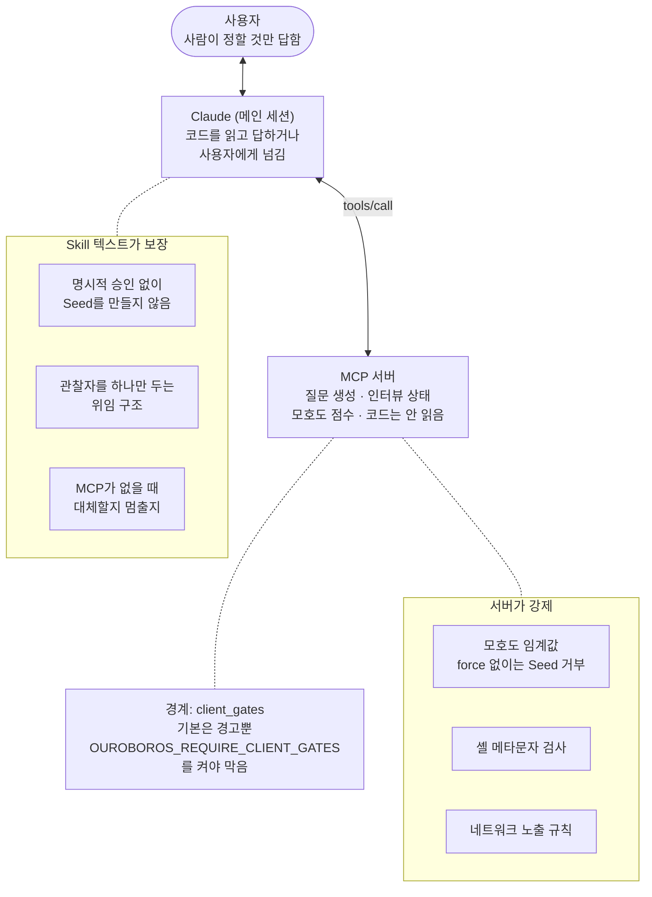

배포된 Skill 중 `client_gates`를 넘기는 곳이 없어서, 기본 사용에서는 게이트를 지키는지를 Skill 텍스트만이 보장합니다.

### 11.2 모든 MCP Skill에 공통인 절차

1. **도구 탐색.** 지연 로드된 도구를 `+ouroboros <x>` 같은 질의로 불러오고, 결과가 비어도 실패로 보지 않습니다(`skills/interview/SKILL.md:91-107`).
2. **매 호출 직전에 다시 로드.** 턴마다 스키마가 내려갈 수 있어서입니다. 지키지 않으면 "Invalid tool parameters"가 납니다(`skills/run/SKILL.md:51-62`).
3. **`response.meta`를 정답으로.** 본문 텍스트를 해석하지 않습니다(`skills/run/SKILL.md:286-293`).
4. **마지막 줄은 현재 상태 한 줄.** 22개 Skill 전부에 적용되고 테스트가 검사합니다(`tests/unit/skills/test_breadcrumb_footer_contract.py:8-18`).

서버도 `instructions` 필드로 도구 선택과 지연 로딩 규칙을 세션 시작 문맥에 넣습니다(약 2KB 예산, `src/ouroboros/backends/capabilities.py:748-790`). **같은 규칙을 Skill과 서버 양쪽에 두 겹으로** 둡니다.

### 11.3 MCP가 없을 때의 정책을 Skill마다 정합니다

| Skill | MCP가 없으면 | 근거 |
|---|---|---|
| auto | 중단하고 보고. "수동 대체는 `ooo auto` 실행이 아니다" | `skills/auto/SKILL.md:31-33` |
| interview, seed | 복구 가능한 오류면 2회 재시도 후, 에이전트 역할극(저장 안 됨)으로 대체 | `skills/interview/SKILL.md:780-830`, `skills/seed/SKILL.md:149-160` |
| evaluate, qa | 자문용 평가로 대체하고 결과가 "advisory"라고 표시 | `skills/evaluate/SKILL.md:129-133`, `skills/qa/SKILL.md:139-143` |
| unstuck, pm | 중단(fail-closed). 하위 에이전트 대체 금지 | `skills/unstuck/SKILL.md:76-84`, `skills/pm/SKILL.md:65-79` |

### 11.4 frontmatter

사용하는 필드는 `name`, `description`, `aliases`, `mcp_tool`, `mcp_args`이고 `allowed-tools`는 쓰지 않습니다. `mcp_tool`·`mcp_args`는 Claude Code가 아니라 Codex·Hermes·OpenCode용 공용 라우터가 `ooo <skill>` 입력을 MCP 도구로 바로 보낼 때 씁니다(`skills/run/SKILL.md:5-8`, `docs/guides/ooo-skill-dispatch-router.md:26-48`). 서버 자신은 `ooo` 문법을 모릅니다(`docs/api/mcp.md:258-262`).

### 11.5 훅은 MCP를 부르지 않습니다

세 훅(세션 시작 버전 확인, 키워드 → Skill 제안, drift 안내)은 파일만 보고, 언제나 exit 0(fail-open)이며, plugin 루트 변수가 없으면 아무것도 하지 않습니다(`hooks/hooks.json:9`, `scripts/session-start.py:24-40`, `scripts/keyword-detector.py:164-170`, `scripts/drift-monitor.py:31-71`).

---

## 12. 테스트와 진단

| 무엇을 고정하나 | 테스트 |
|---|---|
| 런처 인자 배열(핀 포함), `--from`의 extras가 `["mcp"]` 하나 | `tests/unit/test_dependencies_configured.py:196`, `:493` |
| 도구 이름 집합, 이름 중복 없음, 설명 있음 | `tests/unit/mcp/tools/test_definitions.py:1866-1945` |
| SDK v2 공개 API 계약 | `tests/unit/mcp/test_sdk_v2_contract.py:15-40` |
| 실제 `Client`와 통신하는 호환성 | `tests/integration/mcp/test_sdk_v2_compatibility.py` |
| 인증, DNS rebinding, workspace 제한 | `tests/unit/mcp/server/test_network_security.py:1-7` |
| Skill frontmatter의 `mcp_tool` 매핑, footer 계약 | `tests/unit/orchestrator/test_skill_tool_mapping.py:143-160`, `tests/unit/skills/test_breadcrumb_footer_contract.py` |
| 생성되는 능력 가이드 문서(스냅샷) | `tests/unit/test_claude_plugin_skill_guide.py:8-13` |
| 훅의 fail-open | `tests/unit/scripts/test_plugin_hook_manifest.py:39-108` |

진단 명령은 둘입니다. `ouroboros mcp doctor [--json]`은 Python 버전, MCP 주 버전, SDK와 MCP 혼합, EventStore 크기, PID 기록을 읽기 전용으로 보고, 실패가 하나라도 있으면 exit 1입니다(`src/ouroboros/cli/commands/mcp_doctor.py:517-581`). `ouroboros doctor install`은 plugin 캐시와 매니페스트 버전을 대조합니다(`src/ouroboros/cli/commands/doctor.py:340-420`).

---

## 13. 문서와 코드가 다른 곳

코드를 정답으로 봅니다.

1. **도구 수.** `docs/architecture.md:576`과 serve의 docstring(`src/ouroboros/cli/commands/mcp.py:1437-1440`)은 도구를 3개만 적습니다. 서버는 36개를 등록합니다(4.2절).
2. **bridge의 설정 탐색.** `docs/guides/mcp-bridge.md:92`는 `{cwd}/.ouroboros/mcp_servers.yaml`도 찾는다고 적지만, 코드는 일부러 찾지 않습니다(9.4절).
3. **bridge의 도구 중계.** 가이드는 자식 에이전트가 상류 도구를 모두 쓸 수 있다고 적고(`docs/guides/mcp-bridge.md:22-24`, `:56-58`), 빠른 시작도 `ouroboros mcp serve --runtime claude-cli` 다음에 "외부 도구로 seed 실행"을 둡니다(`docs/guides/mcp-bridge.md:49-58`). 코드에는 호출 중계가 없고, 자식에게 넘어가는 것은 이름뿐입니다. plugin 기본 경로(`ouroboros_start_execute_seed`)는 bridge가 없는 detached worker에서 돌아 이름조차 찾지 않습니다(10.4.3~10.4.5절, 실행으로 확인).
4. **bridge 예시 URL.** `docs/guides/mcp-bridge.md:42`의 `http://localhost:3000/mcp`는 SSRF 검사에 걸립니다. `OUROBOROS_ALLOW_LOCAL_TRANSPORT=1`이 필요합니다(`src/ouroboros/mcp/types.py:178-185`).
5. **EventStore 기본 경로.** 문서의 `~/.ouroboros/data/ouroboros.db`는 설정 파일에 그 값이 있을 때만 맞고, 코드의 기본값은 `~/.ouroboros/ouroboros.db`입니다(8절).
6. **`evolve_rewind`.** `skills/evolve/SKILL.md:126`은 "앞으로 만들 도구"라고 적지만 이미 있습니다(4.2절).
7. **run Skill의 도구.** frontmatter의 `mcp_tool`은 동기 `execute_seed`인데 본문은 비동기 `start_execute_seed`를 씁니다(`skills/run/SKILL.md:5`, `:96-108`). 라우터 경로를 타는 호스트와 Claude가 서로 다른 도구를 부를 수 있습니다 (추정).
8. **`~/.claude/mcp.json`.** setup·welcome·pm Skill은 이 파일을 쓰거나 검사하지 말라고 하지만(`skills/setup/SKILL.md:211-213`), 키워드 훅은 이 파일을 setup 판정에 씁니다(`scripts/keyword-detector.py:164-170`). 같은 사실의 원천이 여럿이면 어긋난다는 예입니다.
9. **Claude plugin의 런처 파일.** `.claude-plugin/plugin.json:25`의 `"./.mcp.json"`이 plugin 루트 기준이면 버전 고정이 없는 루트 파일을 읽습니다. 런타임 가이드는 `.claude-plugin/.mcp.json`(고정)이라고 적습니다(`docs/runtime-guides/claude-code.md:23-25`). 어느 쪽인지는 Claude Code의 해석에 달려 있어 확인이 필요합니다.
10. **codex 런타임의 docstring.** "연결 풀은 후속 작업"이라고 적지만(`src/ouroboros/orchestrator/codex_mcp_runtime.py:14-25`) 같은 파일에 풀이 이미 있습니다(`src/ouroboros/orchestrator/codex_mcp_runtime.py:127-129`).
11. **bridge 설정의 자격 증명.** 로더의 docstring은 "자격 증명은 환경 변수로만(평문 없음)"이라고 적습니다(`src/ouroboros/orchestrator/mcp_config.py:23`). 코드는 평문을 거부하지 않고, `${VAR}` 치환도 `env`에만 해서 `headers`의 토큰은 평문으로 적을 수밖에 없습니다(`src/ouroboros/orchestrator/mcp_config.py:238-260`).
12. **bridge의 `health_check_interval`.** 설정으로 받지만(`src/ouroboros/mcp/bridge/config.py:27`), 점검 루프를 띄우는 코드가 src에 없습니다(10.4.1절).

---

## 14. 작은 MCP 서버를 만들 때: 가져올 것과 가져오지 않을 것

Challenge의 예시 plugin(`Day04_new/use_cc/challenge/examples/example-tasks/`)과 나란히 놓고 봅니다.

### 가져올 것

| Ouroboros에서 | 작은 서버에서는 | Challenge 예시에서 |
|---|---|---|
| 예외는 경계 한 곳에서만 바꾸고, 예상된 실패는 값으로(5.1) | 업무 오류를 `success:false` + 오류 코드 **값**으로 돌려준다. 채널을 하나로 둔다 | 관례 1, 검사기의 계약 사례 |
| description의 "Use when / Do not use when / Result"(4.1) | 도구 설명에 **언제 쓰는지**와 업무 오류 코드를 적는다 | 기준표의 "도구 설명" 리뷰 기준 |
| 결과에 다음 도구를 부를 ID와 이름을 넣기(4.3, 6.1) | `task_id`처럼 다음 호출에 필요한 값을 결과에 넣는다 | `add_task` 결과의 `task` |
| 중복 방지 장치마다 막는 실패를 짝짓기(7절) | 부작용 도구 하나마다 "두 번 오면?"에 답하고 계약 사례로 확인한다 | 관례 2, `add-twice-is-idempotent` |
| stdio의 stdout은 JSON-RPC 전용, 진단은 stderr(`src/ouroboros/cli/commands/mcp.py:92-93`) | 그대로 | 관례 5, 검사기의 stdout 오염 검사 |
| 기동을 늦추지 않기, 의존성 누락은 기동 시점에 실패(2.4) | 무거운 일을 도구 호출로 미룬다 | — |
| Skill마다 MCP가 없을 때의 정책을 적기(11.3) | 중단할지 대체할지 SKILL.md에 한 줄로 적는다 | (권장) |
| Skill과 서버에 같은 규칙을 두 겹으로(11.2) | 판단할 수 없을 때 막는 일은 서버가, 사람에게 물을지는 Skill이 | 기준표의 "판단할 수 없을 때" |
| 계약을 테스트로 고정(12절) | 계약 사례와 eval 사례가 그 역할을 한다 | `checks/contract.jsonl`, `evals/` |
| 신뢰 경계를 코드 주석으로 남기기(9.4) | 왜 그 폴더만 읽는지, 왜 그 입력을 막는지 주석에 적는다 | — |

### 따라 하지 말 것 (반례로 쓸 것)

| Ouroboros에서 | 왜 |
|---|---|
| annotations가 36개 중 1개(4.4) | 호스트가 도구의 위험을 알 수 없다. Challenge는 모든 도구에 네 개 모두를 요구한다 |
| enum을 description에만 적기(4.4) | 스키마 검증이 오타를 못 잡는다. 정해진 값은 스키마 enum으로 |
| 같은 이름의 도구를 조용히 덮어쓰기(4.4) | 등록 실수가 드러나지 않는다 |
| `error_code`가 있으면 JSON-RPC 오류로(5.3) | 클라이언트마다 모델에게 보이는 모양이 다를 수 있다 |
| 프로젝트 폴더를 cwd로 짐작(9.3) | 띄운 곳에 따라 상태 위치가 바뀐다. `${CLAUDE_PROJECT_DIR}`처럼 명시적으로 받는다 |
| 문서가 코드보다 뒤처짐(13절) | 같은 사실의 원천을 하나로 두거나 테스트로 묶는다 |
| bridge: 외부 도구 이름이 목록·이벤트·로그에 다 나오는데 부르는 경로는 없음. 시험은 주입만 확인(10.4절) | 목록에 보이는 것과 부를 수 있는 것은 다르다. 검사기(모양)와 eval(실제 행동)이 서로 다른 것을 보는 이유와 같다. Challenge는 eval로 실제 호출을 확인한다 |

### 작은 서버에는 대개 필요 없는 것

- **detached worker와 job 모델 전체.** 몇 분 넘게 걸리는 작업이 없다면 필요 없습니다. 다만 "stdio 서버 안의 태스크는 턴과 함께 죽는다"(6.3)는 사실은 알아 둡니다. 오래 걸리는 일이 생기면 시작/상태/결과로 나누는 것부터 합니다.
- **스키마를 직접 소유하기.** SDK의 시그니처 추론(`Annotated[..., Field(description=...)]`, `Literal`)으로 충분합니다. Ouroboros는 이것을 직접 소유하느라 등록 경로가 둘이 됐습니다(3절).
- **세 겹의 중복 방지.** 프로세스를 넘는 재시도가 없다면 도구 안의 중복 방지 하나로 충분합니다.
- **네트워크 전송의 인증·rebinding 방어.** stdio로만 띄운다면 필요 없습니다. 네트워크로 열 때는 9.1의 규칙이 좋은 기준입니다.
- **자기 자신을 끄는 재귀 방지.** 다른 에이전트를 런타임으로 부르지 않는다면 필요 없습니다.

---

## 15. 확인하지 않은 것

- 고정 버전 `mcp==2.0.0`의 SDK 내부 동작. 2.3.0 소스로만 확인했습니다. 특히 `.tool()` wrapper가 기본 `tools/call`에서 쓰이지 않는다는 해석(3절)은 2.0.0에서 다를 수 있습니다.
- Claude Code가 `plugin.json`의 `"./.mcp.json"`을 어느 폴더 기준으로 해석하는지(13절 9번).
- bridge(10.4절)에서 확인하지 않은 것: 모델을 부르는 seed 실행 전체. Claude Agent SDK 런타임에서 `allowed_tools`에 들어간 `ext_` 이름이 하는 일(SDK와 mcp 2를 같은 환경에 깔 수 없음). `TRANSLATED` 런타임 각각의 번역 방식(Codex CLI만 확인). 자식이 자기 설정으로 같은 서버를 가졌을 때 실제로 부르는지. 다른 Start 도구(auto, evaluate, evolve, ralph)의 worker 안 동작.
- 다른 프로세스의 worker가 취소 표시를 보는 정확한 경로(6.4절).
- 텔레메트리로 실제 전송되는 필드 전체. 이벤트 이름과 정규화 규칙만 확인했습니다.
