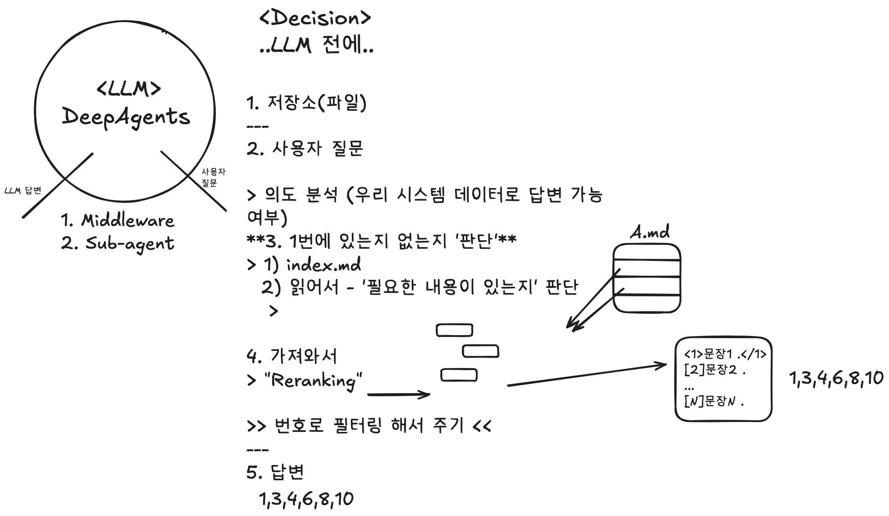

1. 업로드 하는 파일 OR 이미 가지고 있는 파일
   - 텍스트 파일은 정해진 경로에 저장, 인용해서 대답할 수 있도록
   - PDF 는 거부.
   - 이미지는 '모델' 이 처리 가능하면 처리해서 대답.

JEV(Decision Model) -> "Tool Call" 로 동작하면 의미 없음.

2. Jev 모델 또는 LLM 중 싼 모델을 적절하게 활용하여 RAG 프로세스를 어떻게 개선할 수 있을까요? 

아래 이미지를 참고해서 개선하는 방향을 고려하세요!

---

## 읽어보면 좋을 글

1. https://github.com/google/elephant-goldfish-model

2. https://www.langchain.com/blog/how-we-optimized-browser-use-for-deep-agents

3. https://www.langchain.com/blog/context-engineering-challenges-late-2026