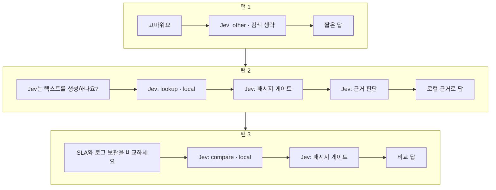
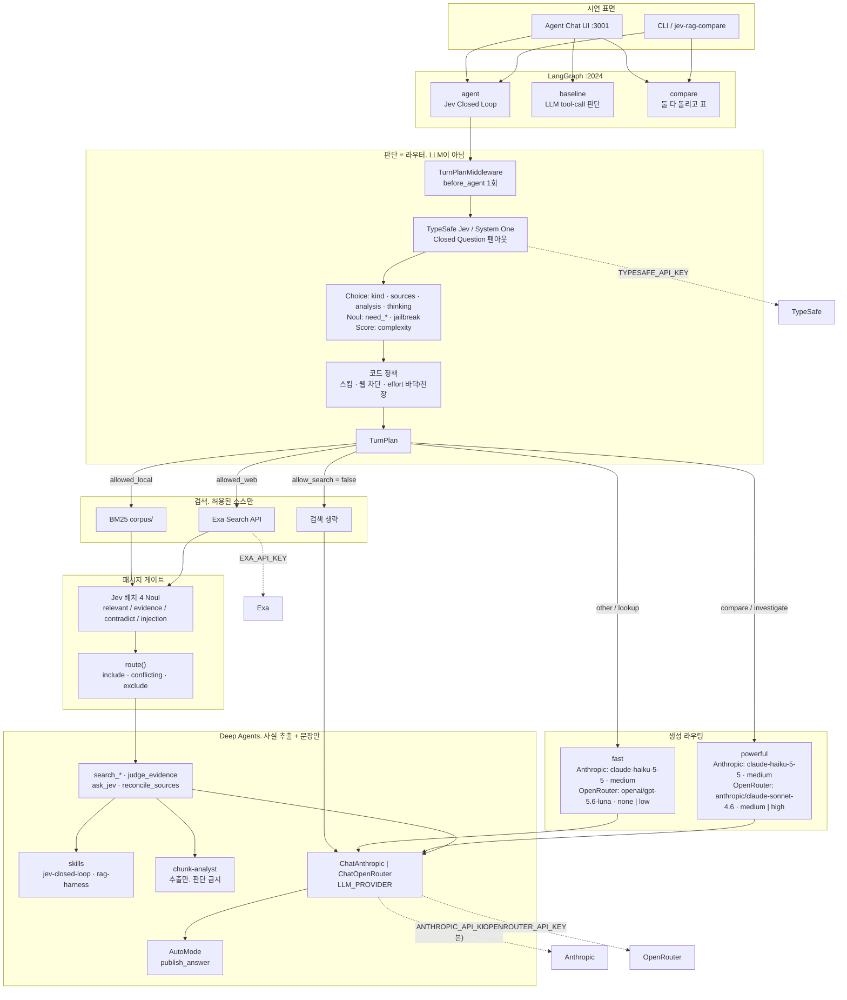
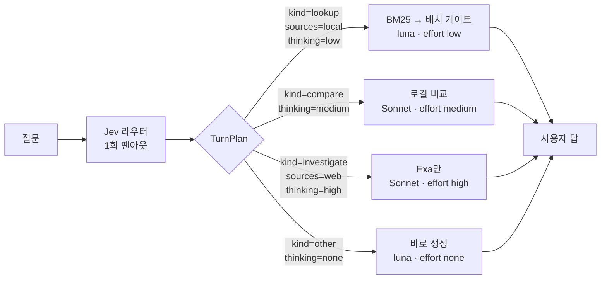

# Jev 모델을 활용한 Deep Agents 기반의 간단한 RAG

Jev는 문장을 쓰지 않는 모델입니다.
**한 턴의 판단을 Closed Question으로 끝내고**, 채팅 모델은 그 질문 안에서만 생성하도록 만들어 줍니다.

Deep Agents는 검색·파일·서브에이전트를 도는 루프. 
판단하는 엔진만 Jev 를 이용하도록 가볍게 구성.

- `agent` — Jev Closed Loop (라우터)
- `baseline` — 같은 슬롯을 LLM tool-call
- `compare` — 둘 다 돌리고 비교

생성은 일반 LLM. 기본은 Anthropic API(`claude-haiku-5-5`, effort `medium`)이고,
`.env`에 `LLM_PROVIDER=openrouter`를 넣으면 OpenRouter를 쓴다.


기존과 다르게 **무엇을 검색할지, 어떤 청크를 남길지, 얼마나 생각할 지** 등의 '판단'은 Jev에게 위임.

## 프로세스

문장은 채팅 모델이 쓰고, Jev는 검색을 할지·어디를 볼지·청크를 남길지 등 판단하는 과정에서만 Jev 사용.




## 시스템 구성도




## 싱글 턴



그림의 모델·effort는 `LLM_PROVIDER=openrouter` 기준이다. 기본(Anthropic)은 네 경로 모두
`claude-haiku-5-5` · effort `medium`이고, 검색·게이트 경로는 같다.


## 모델 라우팅


| Jev가 고른 것                   | 검색        | OpenRouter 모델                   | OpenRouter `reasoning.effort` | Anthropic (기본)                 |
| --------------------------- | --------- | ----------------------------- | ----------------------------- | ------------------------------ |
| `kind=other` / jailbreak 스킵 | 없음        | `openai/gpt-5.6-luna`         | `none`                        | `claude-haiku-5-5` · `medium` |
| `kind=lookup`               | 로컬만 (기본)  | luna                          | `low`                         | `claude-haiku-5-5` · `medium` |
| `kind=compare`              | 로컬만 (기본)  | `anthropic/claude-sonnet-4.6` | `medium`                      | `claude-haiku-5-5` · `medium` |
| `kind=investigate`          | 웹 또는 both | Sonnet                        | `high`                        | `claude-haiku-5-5` · `medium` |

Anthropic 경로는 한 모델과 한 effort로 고정한다(`src/agent/config.py`의 `CHAT_MODELS`,
`ANTHROPIC_EFFORT`). Jev가 고른 thinking은 계획 카드와 Langfuse에 그대로 남지만 Anthropic
요청에는 쓰지 않으므로, 아래 "생성" 레이어의 절감은 OpenRouter 경로에서만 생긴다.
`temperature`도 보내지 않는다(Claude 5.5 모델은 기본값이 아닌 샘플링 값을 거절한다).
`baseline`의 LLM 판단 호출은 강제 tool-call로 답을 받으려고 그 호출에서만 thinking을 끈다.


코드가 Choice 위에 Harness 를 걸어둠.

- 검색이 꺼지면 thinking은 항상 `none`.
- lookup은 항상 `low`. Jev가 `high`를 골라도 내린다.
- compare / 서브에이전트는 최소 `medium`.
- 비번·secret 질의는 웹을 끈다 (`allowed_web=false`).
- `EXA_API_KEY`가 없으면 웹을 끈다.


빨라지는 레이어는 두 군데이다.

1. **판단** — 스킵 · 소스 Choice · 패시지 배치 게이트. 호출 횟수가 줄어든다.
2. **생성** — 모델 + Thinking Level. 문장 생성의 reasoning 예산이 줄어든다.

## Closed Question

한 요청에 질문을 모은다. 열린 프롬프트는 쓰지 않는다.


| id                                                                 | 타입     | 의미                                     |
| ------------------------------------------------------------------ | ------ | -------------------------------------- |
| `kind`                                                             | Choice | lookup / compare / investigate / other |
| `sources`                                                          | Choice | local / web / both / none              |
| `analysis`                                                         | Choice | self_read / chunk_analyst              |
| `thinking`                                                         | Choice | none / minimal / low / medium / high   |
| `need_search` `need_local` `need_web` `need_fresh_web` `jailbreak` | Noul   | 검색·탈옥 확률                               |
| `complexity`                                                       | Score  | 합성량                                    |


패시지마다가 아니라 shortlist 전체를 한 요청으로 게이트한다.


| id                          | 타입   | 다음 동작 (`route()`)        |
| --------------------------- | ---- | ------------------------ |
| `is_relevant`               | Noul | 낮으면 exclude              |
| `contains_answer_evidence`  | Noul | 답에 쓸 사실                  |
| `contradicts_query_premise` | Noul | 높으면 conflicting_evidence |
| `contains_prompt_injection` | Noul | 높으면 exclude (포럼 주입)      |


턴 중간 판단은 `ask_jev` / `judge_evidence` / `reconcile_sources`다. chunk-analyst는 사실을 베끼기만 한다.


## 그래프


| Assistant ID | 판단 엔진                           | 역할                  |
| ------------ | ------------------------------- | ------------------- |
| `agent`      | Jev Closed Loop                 | 시연 기본. 라우터 + 배치 게이트 |
| `baseline`   | 같은 슬롯을 LLM structured tool-call | 기존 방식. 패시지마다 한 번    |
| `compare`    | 둘 다 실행                          | 품질·속도 표             |


## 주요 코드


| 경로                                      | 역할                                          |
| --------------------------------------- | ------------------------------------------- |
| `src/middleware/turn_plan.py`           | `before_agent` 팬아웃. 모델·effort 고정. 스킵된 툴 차단  |
| `src/harness.py`                        | Jev 질문 정의, `plan_turn`, 배치 게이트, thinking 정책 |
| `src/jev.py`                            | TypeSafe `system_one` / fallback            |
| `src/llm_harness.py` `src/llm_judge.py` | baseline용 동일 슬롯                             |
| `src/retrieve.py`                       | 계획된 검색 vs naive 항상 검색                       |
| `src/agent/graph.py`                    | Deep Agent 조립 (`agent`)                     |
| `src/agent/config.py`                   | `LLM_PROVIDER`, `chat_model(settings, model, thinking_effort=)` |
| `workspace/skills/jev-closed-loop/`     | Closed Question 작성 규칙                       |
| `corpus/`                               | BM25 색인. SLA·온콜은 시연용 가짜 데이터                 |
| `frontend/`                             | Agent Chat UI. 레포에 넣지 않음. 아래 방법으로 받음        |


## 실행

```bash
uv sync
uv run jev-rag-ui
```

`frontend/`는 커밋하지 않는다 (`README.md` · `.env.example`만 추적).  

`jev-rag-ui`가 [Agent Chat UI](https://github.com/langchain-ai/agent-chat-ui)를 통해서 실행된다

```text
frontend/package.json 없음
  → git clone --depth 1 https://github.com/langchain-ai/agent-chat-ui.git
  → .env 작성 (API :2024, assistant=agent)
  → pnpm install
  → LangGraph API + Next UI 기동
```

Node와 `pnpm`이 필요하다. `pnpm`이 없으면 `npx pnpm@10.5.1`로 설치한다.
이미 `package.json`이 있으면 클론을 건너뛴다. UI는 `:3000`부터 빈 포트를 쓴다.

`frontend/`에는 추적 파일이 있어서 그 자리에 바로 `git clone`하면 실패한다. 수동이면:

```bash
git clone --depth 1 https://github.com/langchain-ai/agent-chat-ui.git frontend/.clone
# .clone 내용을 frontend/로 옮긴다. 기존 README.md · .env.example은 유지.
# frontend/.git 과 frontend/.clone 은 지운다.
cp frontend/.env.example frontend/.env
cd frontend && pnpm install && pnpm dev
```

자세한 절차는 [frontend/README.md](frontend/README.md).

## 환경

```env
LLM_PROVIDER=anthropic  # 채팅 공급자. anthropic(기본) 또는 openrouter
ANTHROPIC_API_KEY=...   # LLM_PROVIDER=anthropic일 때. claude-haiku-5-5 · effort medium
OPENROUTER_API_KEY=...   # LLM_PROVIDER=openrouter일 때. langchain-openrouter만
TYPESAFE_API_KEY=...     # Jev System One
EXA_API_KEY=...          # 선택. 없으면 웹을 건너뜀

LANGFUSE_PUBLIC_KEY=...  # 선택. 트레이스 + 골드 실험
LANGFUSE_SECRET_KEY=...
LANGFUSE_BASE_URL=https://jp.cloud.langfuse.com
LANGFUSE_TRACING_ENVIRONMENT=demo
```

키가 있으면 `agent` / `baseline` / `compare` 턴이 Langfuse 트레이스로 올라가고,  
`uv run jev-rag-compare`는 데이터셋 `jev-rag-gold`에 실험 런을 남긴다.  
저장된 JSON만 올리려면 `uv run jev-rag-compare --publish-saved`